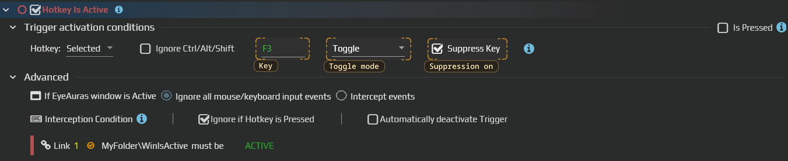

# Hotkey Is Active — start an action with a key

Hotkey Is Active watches a key, a combination or a mouse button. In the example below you press F6 and the aura plays a sound. The action is in On Enter, so it runs at the moment the aura becomes active.

## Try F6 as a toggle

Notepad is a handy place to test. If F6 is already taken on your computer, choose another free key.

1. Create an aura with one **Hotkey Is Active** trigger. Some versions spell the name HotkeyIsActive.
2. Keep **Hotkey** set to **Selected** and assign F6 in the combination editor.
3. Set **Mode** to **Toggle Trigger state on Click** (Toggle in the older editor). Leave **Suppress Key** off and do not add interception conditions yet.
4. Add [Play Sound](/en/actions/play-sound) with Ping to **On Enter**. Check the volume with the preview button.
5. Switch to Notepad, then press and release F6. Do it two more times.

The first press turns the trigger on and plays Ping. The second turns it off without a sound. The third turns it on again and the sound repeats. On Enter does not repeat while the trigger stays active. For actions that should repeat, use **While Active**.

In Toggle mode, presses in EyeAuras's own windows are ignored by default. That is why we test in Notepad. To test right in the EyeAuras editor, enable handling of EyeAuras windows under Advanced. This limit does not apply to Hold.

## Main settings

| Setting | Effect |
|---|---|
| Hotkey — Selected | Watches a specific key, combination, mouse button or wheel direction. Set mouse and wheel input in the combination editor. |
| Mode — Hold | Active while the key or button is held. |
| Mode — Toggle Trigger state on Click | Switches state after you press and release. The first press turns it on, the next turns it off. |
| Suppress Key | Stops the press from reaching other applications. Not every kind of input can be suppressed. Without interception conditions, suppression may also apply outside the application you meant. |
| Ignore Ctrl/Alt/Shift | The trigger fires even while modifiers are held. If the assigned combination itself contains modifiers, this setting resets. |
| Is Pressed | In the older editor it shows the state. You can switch it by hand for a quick check. |

Track any key or mouse button

Instead of Selected, you can choose an input group.

| Group | Input tracked |
|---|---|
| Any Keyboard key | Any keyboard key. |
| Any Mouse button | Any mouse button. |
| Any Keyboard/Mouse key | Keyboard keys and mouse buttons. |

These groups do not track mouse movement or idle time. A wheel direction is assigned as a specific combination in Selected.

## Handle the key only in the intended window

1. Create a separate aura called “Notepad active” with [Window Is Active](/en/triggers/window-is-active). Set Target Window to `notepad` and check the matches.
2. Go back to Hotkey Is Active. In **Advanced → Interception Condition → Links**, add “Notepad active” as an Active condition.
3. Set **Mode** to Hold. Hold F6 briefly in Notepad, then do the same in another program. The sound should play only in Notepad.

If you use Toggle, choose what happens when you leave the window:

| Advanced setting | Effect |
|---|---|
| If EyeAuras window is Active | Intercept events allows handling in EyeAuras windows. Ignore all mouse/keyboard input events turns it off for Toggle, while Hold keeps working. |
| Ignore If Hotkey Is Pressed | A toggle that is already on is still handled after the linked condition stops matching. This lets you turn Toggle off from another window. It has no effect on a toggle that is off. |
| Automatically deactivate Trigger | Turns off an active trigger when its interception condition stops matching. After you return to the window, turn Toggle on again. |

With several links, check their required states and the rule that combines them.
