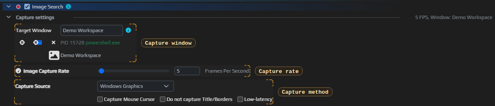

# Choose the capture source for image, text or colour search

You came here through the older **Image / Text / Color Search** address. There is no separate old trigger. This is the shared capture section that every search trigger has. The [current capture guide](/en/triggers/images/imagecapturetriggers) explains how it works.

## Inspect your own source before adding a condition

Example: you want to watch the colour of a small indicator in your own application. First make sure the trigger sees the right area. The colour and the reaction come later.

1. Open your application and add **Color Search** to your aura.
2. In **Capture settings → Target Window**, select its window. Set **Image Capture Rate = 5 Frames Per Second**.
3. Open **Preview captured image**. If the image is wrong, open **Show more... → Capture Source** and compare the available methods. Start with **Windows Graphics** if it is there.

   
4. Use **Crop region** and the preview to crop down to the indicator. Change the indicator in your application and check that the same area changes in the capture.

The trigger now gets fresh pixels of your indicator. That is not **Active** yet. For that, set up the [Color Search](/en/triggers/images/color-search) condition.

| Earlier label | Current correspondence |
| --- | --- |
| `Target FPS` | **Image Capture Rate**. The capture and analysis rate you ask for. Heavy processing can lower the actual FPS. |
| `Mouse Cursor` | **Capture Mouse Cursor**. Not every capture source can capture the cursor. |
| `Settings → Max Capture FPS` | A global limit for triggers. It can cap the rate a single trigger asks for. |
| Capture method | **Show more... → Capture Source**. After switching, check the pixels and bounds again. |

| Capture Source | How to evaluate it |
| --- | --- |
| `Windows Graphics` | Captures a window through Windows Graphics Capture. Available if your Windows supports it. Its system border can be turned off only if the matching API is present. |
| `Shared Surface` | Another way to get the window's surface through the graphics system. Compare its frame if the system method does not fit. |
| `Desktop duplication` | Captures the desktop through the GPU and cuts out the region. Watch out for windows that overlap it. |
| `Print Window` | A Win32 window method. Applications that draw with hardware can return an empty or incomplete frame. |
| `Copy Device Context` | A GDI method that works with some windows. |
| `Copy From Screen` | A copy of the visible screen area. It depends on where the window is and what covers it. |

First check that the picture is right. Then look at the actual FPS and processing time in the preview tooltip. Do not expect fresh frames from a minimised or unavailable window.

Cropping and effects are covered in the [current guide](/en/triggers/images/imagecapturetriggers). Once the source is set up, choose what to search for: an [image](/en/triggers/images/image-search), a [colour](/en/triggers/images/color-search), [text](/en/triggers/images/text-search) or [AI Search](/en/triggers/images/ai-search-trigger).
