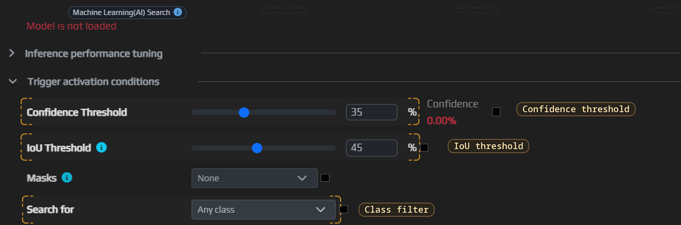
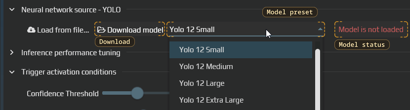

# AI Search — find classes learned by a model

AI Search finds objects with a neural network. It takes an image of the chosen window, gives it to the model, and becomes active if the model finds the class you asked for with enough confidence. For example, a person in a photograph, in any pose and at any size. That needs a model trained on the **person** class.

Unlike Image Search, you do not load a sample picture here. What the trigger can find depends only on the model. Typing a new class name does not train it.

## Find a person in your own photograph

Take one of your photographs with a clearly visible person and open it in an ordinary image viewer. Downloading the model for the first time needs internet access. The example uses **Yolo 8 Nano** from the list. Check that the loaded model lists the COCO class **person**. You also need a supported capture source and a working inference provider.

1. Add **AI Search** to an aura. Select the photo viewer in **Capture settings → Target Window** and set **Image Capture Rate = 1**.
2. Expand **Preview captured image**. Use **Crop region** to keep only the photograph, without the viewer controls. The person must be clearly visible. If the frame is wrong, fix the [capture](/en/triggers/images/imagecapturetriggers) first.
3. Under **Neural network source - YOLO**, select **Yolo 8 Nano** and click **Download model**. Wait for **Model is loading...** to go away. While you see **Model is not loaded** or a loading error, there is nothing to search with.
4. Under **Inference performance tuning → Provider**, choose **Cpu** if it is listed. Leave the thread counts alone for now. This example does not need a GPU.
5. Under **Trigger activation conditions → Search for**, select **person**. Set **Confidence Threshold = 50%** and **IoU Threshold = 45%**, then click **Refresh Once**.

   

6. Look at the result list and the preview. If the model found a person with a score **strictly above 50%**, the result is in the list and the trigger becomes active. For a detection model, turn on **Bounding Boxes** and **Labels** in the preview to see the box and the class.
7. Open a photograph without people in the same viewer and refresh. With no matching result, the trigger should become inactive. Put the first photograph back and check again.

A model can miss a person or take something else for one. If there is no result, check the frame, the selected class and the scores, and try a clearer photo. Lowering the threshold lets more weak results through.

## Model and input

| Control or information | Meaning |
| --- | --- |
| Download model | Downloads the selected preset. The list currently has the Yolo 8, 10, 11, 12 and 12-turbo families in several sizes. |
| Yolo 8 Classification / Segmentation variants | They do a different job: classify the whole frame, or find objects with masks. The example uses the ordinary Yolo 8 Nano detection model. |
| Load from file... | Loads your own ONNX model. Not every ONNX file fits, and .pt weights do not. The input and output layout, the task and the parser must agree. |
| Save... / Clear | Saves the model to a file or removes it from the trigger. |
| Loaded-model information | Shows the task, input size and labels. The example model has a 640×640 input. Model preprocessing fits the frame to that size. |
| Search for | The class names of the loaded model. Any class accepts any class, not just person. |
| Confidence Threshold | Drops results with a low score. The score must be strictly greater than the threshold. |
| IoU Threshold | Removes detections that overlap each other. |

A detection model returns boxes. Segmentation adds masks to them. Classification scores the image as a whole and does not have to locate objects. In every case the trigger checks the remaining results of the selected class.

Compatibility, performance and diagnostic marks

| Setting or requirement | Check |
| --- | --- |
| ONNX layout | The loader expects an `images` input and supported output shapes and metadata. It picks classification for one rank-2 output, detection for one rank-3 output, and segmentation for two outputs where the first is rank-3. A YOLO name alone does not make a model compatible. |
| Preprocessing | The processed capture is stretched to the model input size, and the results are mapped back. You do not always need to resize by hand, and doing so can lose small objects. |
| Calculation threads | Threads inside the model computation. More threads load the CPU more and may not be faster. |
| InterOp threads | Threads between graph nodes. Change the value only after measuring processing time. |
| Provider | What runs the model. Cpu uses the processor. Cuda, TensorRt and DirectML depend on your hardware and installed components. A referenced SDK does not install or register them. |
| Image Capture Rate | How often analysis is requested. Start at 1 FPS, because a model may not keep up with more frequent frames. |
| Preview Bounding Boxes / Labels / Masks | Show what was found. Masks is for segmentation models. |
| On-screen-display → Window / Region / Bounding Boxes / Labels / Masks | Separate marks drawn over the source window. Masks needs segmentation. Turn off the marks you do not need afterwards. |

Watch **Processing time** in the FPS tooltip. Result coordinates belong to the processed capture, so do not scale them a second time.

You prepare your own model outside this editor. The [Ultralytics documentation](https://docs.ultralytics.com/) and the [detector training guide](https://docs.ultralytics.com/tasks/detect/#train) explain where to start. The [IoU explanation](https://www.pyimagesearch.com/2016/11/07/intersection-over-union-iou-for-object-detection/) describes what box overlap is.

If the preset has no class you need, start with [preparing data and a model in YoloEase](/en/YoloEase/getting-started). That tool has its own version and environment requirements. Come back here with a compatible ONNX model and check its task and classes before adding a reaction.

Once the trigger tells the photographs apart reliably, add an **OnEnter** action such as [Play Sound](/en/actions/play-sound).
