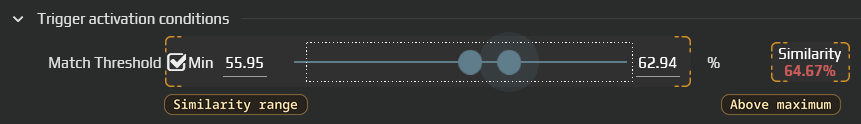

# Color Search — detect an indicator's color change

Color Search watches the color of an area in a window. For example, it notices a gray indicator turning green for “ready”. The trigger takes pixels from the chosen window, compares them with **Target Color**, and checks whether the similarity is within the range you set.

You need an indicator with an evenly colored center that you can switch to another state. Keep text, borders and the panel background out of the region, because they change its average color.

## Check a green indicator

1. Open the application while its indicator is green. Add **Color Search** to an aura.
2. Select the window in **Capture settings → Target Window**, set **Image Capture Rate = 5** and expand **Preview captured image**.
3. Use **Crop region** to keep only the solid center of the indicator. If the color in the preview is wrong, fix the [capture source](/en/triggers/images/imagecapturetriggers) first.
4. Set **Comparison Granularity — Aggregate Average Color of Entire Area** and **Comparison Method — Human Perception**.
5. Click **Copy Captured Color to Target Color**. The average color of the area becomes the reference. Check that **Target Color** shows it.
6. Under **Match Threshold**, turn on **Min** to see both limits. Set **Min = 95%** and **Max = 100%**. While the indicator does not change, Similarity should be near 100% and the trigger active.
7. Switch the indicator to gray or its other normal state. Similarity should leave the range and the trigger should become inactive. Put green back and check again.

If both states pass, check the region and the actual Similarity for each state. Put the limit between them.

## Choose the color and comparison

| Setting | Meaning |
| --- | --- |
| Target Color | The color the frame is compared with. You can also enter it by hand. |
| Captured Color | The average color of the whole captured area. In local modes it may differ from the color of the patch that was found. |
| Copy Captured Color to Target Color | Copies that whole-area average into the reference. |
| Pick Color from Preview Pane | Takes one specific color from the preview instead of the area average. |
| Human Perception | CIEDE2000. Compares colors the way people tell them apart. |
| Mathematical | Euclidean distance in the RGB channels. |
| Match Threshold | The allowed similarity range, limits included. For example, 95–100% means a close match. A low range can test that the color is different. |
| Similarity | The current comparison score. It is not always the share of pixels that have the target color. |

Comparison Method applies only to the whole-area average. The individual-pixel and block modes use color-template matching instead. Do not carry over thresholds tuned for CIEDE2000 to them.

## Whole area, pixel or block

| Comparison Granularity | Use |
| --- | --- |
| Aggregate Average Color of Entire Area | Check the overall state of a small area, as in the indicator example. Every pixel affects the average. |
| Individual Pixel Color | Find at least one matching pixel inside the region. Random noise can match too. |
| Average Color of 2x2 / 4x4 / 4x8 / 8x4 / 8x8 / 16x16 / 32x32 Pixel Blocks | Find a local patch of the selected size. The block must fit in the frame. The block's color is compared, not the average of the whole window. |

If the indicator stays in place, start with a small region and its average color. If a colored mark moves around inside a panel, a local mode fits better. Limit the search to the panel, or the trigger may fire on a similar color somewhere else.

Measure a visual bar's filled fraction

The trick with a white filled part and a black empty part works for a simple progress bar. Use [Effects...](/en/triggers/images/effects) to turn the two colors into white and black, and remove borders and text. Then compare the whole-area average with white using **Mathematical**. For an ideal two-color bar, similarity equals the share of white pixels.

Check known states first: an empty, a half-filled and a full bar. Gradients, glow, text and rounded corners break this relationship. Inversion in Color Removal/Replacement changes the prepared pixels. It is a different thing from the trigger's similarity range.

Once the two states are told apart reliably, add a reaction to **OnEnter**, such as [Play Sound](/en/actions/play-sound).
