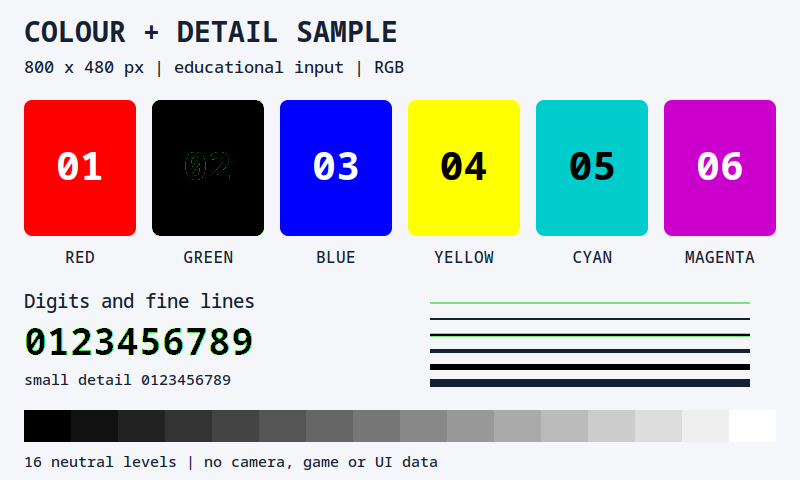
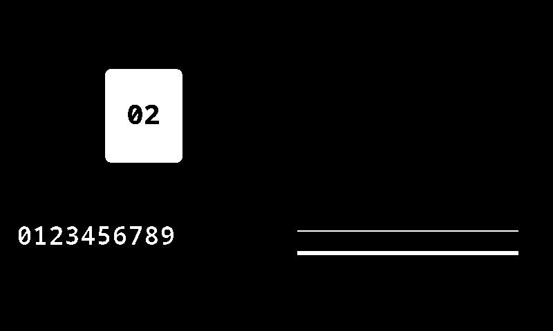
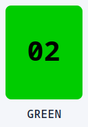
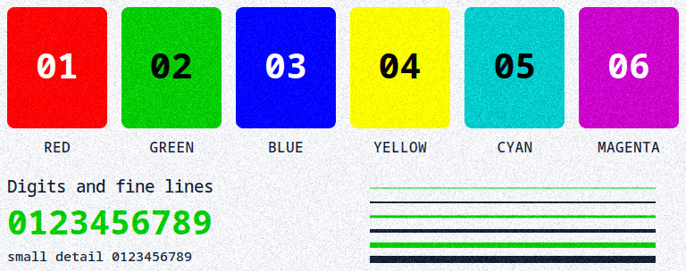
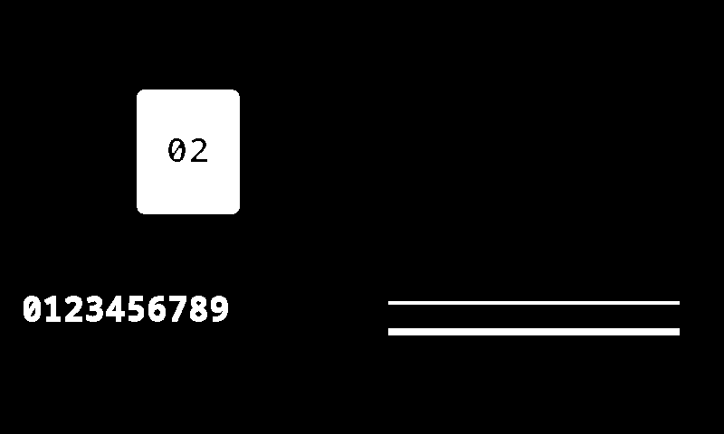
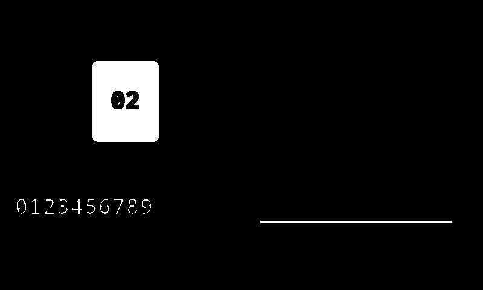
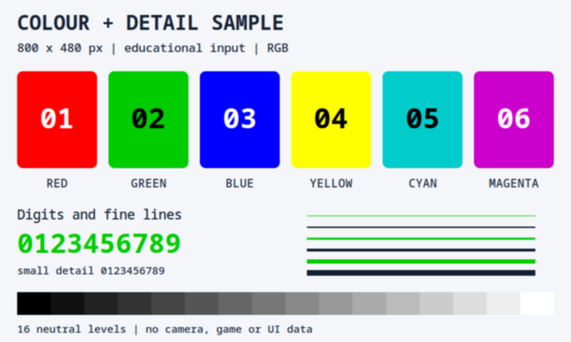
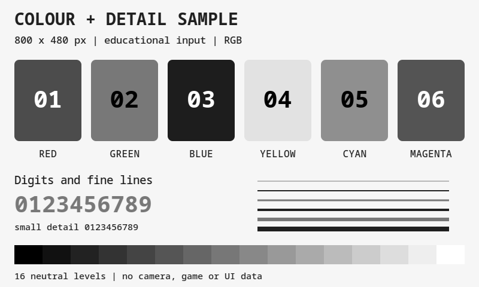
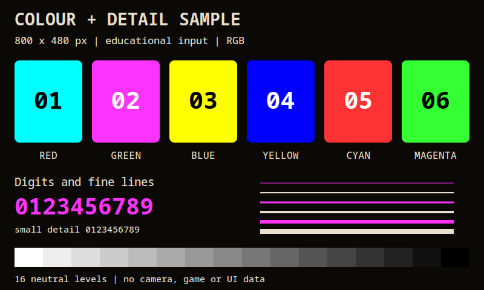
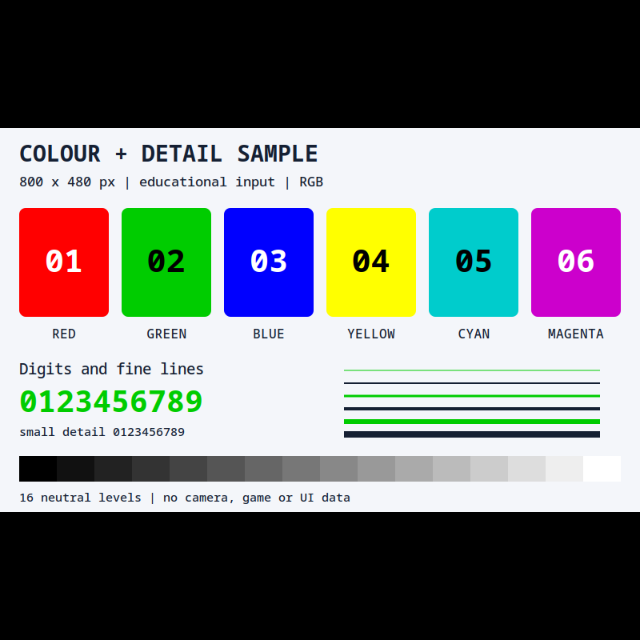

# Image Effects — prepare captured pixels for analysis

If light lettering on a dark background is hard to recognize, try Grayscale followed by Negate. Effects change captured pixels **before analysis**. They do not change the source window or run a reaction themselves.

Other effects can remove a color, join bright fragments, reduce image size or keep a useful region. A filter can also destroy useful detail: inspect its output and the actual search result separately.

## Make dark text on a light background

Start with a configured capture trigger whose preview contains light text on a dark background. This first check changes the preview image; you do not need to retune the text condition yet.

1. Beside **Preview captured image**, click **Effects...**.
2. In **Image Effects**, click **Add**, choose **Grayscale** and leave its checkbox enabled.
3. Add **Negate** after it. Use the up/down controls if necessary: Negate should follow Grayscale.
4. Return to preview in **Image as is** mode. The colors should disappear and light letters become dark against a lighter background.
5. Switch to **w/o effects** to compare with the original frame, then return to Image as is.
6. If the letters are less clear, disable Negate or remove an unnecessary effect. Test actual text recognition separately; an attractive preview does not establish a better OCR result.

Effects run in order. Cropping before resizing and cropping afterwards operate on different image dimensions and coordinates. Recheck the final frame and search region whenever the chain changes.

| Editor control | Action |
| --- | --- |
| Add | Adds an effect to the chain. |
| Effect checkbox | Skips an effect while retaining its settings. |
| Move effect up / down | Changes processing order. |
| Remove effect | Removes the effect after confirmation. |
| Copy / Paste effects | Transfers chain settings through the clipboard. |
| Effect region, where supported | Limits processing to part of the frame. Availability and geometry depend on the effect. |

## Choose a transformation

| Effect | Purpose and limit |
| --- | --- |
| Color Removal - HSV Range | Sets selected HSV-range pixels to black, not template transparency. Invert selects the opposite mask. |
| Color Replacement - HSV Range | Replaces matching and optionally nonmatching pixels with configured colors. The two replacement switches are independent; Invert swaps the assigned colors, not those switches. |
| Crop | Keeps a frame region. The capture trigger also has its own Crop region. |
| Denoise | Non-local Means noise reduction; useful small details can change too. |
| Dilate | Expands bright areas and can join gaps. |
| Erode | Shrinks bright areas and can remove small bright features. |
| Gaussian Blur | Smooths small details; can hurt small-text recognition. |
| Grayscale | Removes color while retaining brightness levels, not a strictly two-color image. |
| Negate | Inverts channel values, exchanging light and dark. |
| Sharpen | Emphasizes edges through convolution; it does not guarantee better detection or navigation. |
| Rescale, % | Percentage sizing. 50% of 1920×1080 is 960×540: one quarter as many pixels. |
| Resize, in pixels | Fixed output dimensions; proportional modes with padding avoid stretching the content. |
| Binary Threshold | Converts brightness to thresholded levels. Threshold, MaxValue and Type determine the result; the comparison figure below is not a catalogue of its controls. |
| Color Quantization (alpha) | Reduces the number of colors. Check that distinct useful features have not merged. |

After resizing, an Image Search template must match the **processed** frame. AI model preprocessing already handles its input dimensions; an extra resize can discard small objects rather than improve recognition.

Worked pixel examples

These are educational transformations, not application screenshots or ready-made object-recognition/navigation settings. The numerical examples were authored with source-mapped NumPy calculations; Denoise below was actually processed by native OpenCV 4.13. They do not show execution of the installed EyeAuras effects.

### Shared input and HSV color operations

This is a new teaching card, not a recovered photograph, game capture or EyeAuras UI. The color examples use these exact input pixels. [Native source SVG](/assets/wiki-media/m004-source.svg).

Both examples use the same **inclusive** HSV range:

| Parameter | Value |
| --- | --- |
| H | 55–65 |
| S | 200–255 |
| V | 150–255 |
| Green card patch | RGB (0, 204, 0), HSV (60, 255, 204). |

These are the editor's channel units: H up to 180, S/V up to 255, not degrees and percentages. The range selects saturated green; antialiased edges can fall outside it.

**Color Removal** replaces the selected pixels with black while leaving the others available for analysis.

Invert is off. All **19,194** matching pixels became RGB (0, 0, 0); the other **364,806** pixels remained unchanged. This removes a color rather than identifying an object.

**Color Replacement** can build a binary mask by assigning both pixel sets.

Both replacement switches are enabled, with white RGB (255, 255, 255) for matching pixels and black RGB (0, 0, 0) for nonmatching pixels; Invert is off. The result has **19,194 white** and **364,806 black** pixels. The original nonmatching colors were replaced too.

### Crop

From the [shared card](/assets/wiki-media/m004.png), x = 144, y = 92, width = 128, height = 184. The result is the exact 128×184 pixel slice. These are image coordinates, not screen or window coordinates. Crop, Resize, Grayscale, Negate and Gaussian Blur here were calculated **independently** from the same card, not chained together.

### Denoise — compare noise and detail

Input 768×304 is the card region x = 16, y = 92, width = 768, height = 304. Scalar Gaussian noise with σ = 12 was added equally to all three channels, then rounded and clipped to 0–255. This is synthetic noise; the saved PNG shown here is the exact input to the following operation.

Actual `fastNlMeansDenoisingColored` processing used **Strength = 12**, **Template Window Size = 3**, **Search Window Size = 7**, and internal hColor = 3. This teaching result used **OpenCV 4.13**, separately from EyeAuras with **Emgu/OpenCV 4.9**. Noise is weaker on flat areas, but mottling and fine-edge changes remain; this does not establish better OCR or preservation of every detail.

### Dilate and Erode — the same mask, separate operations

Both results were calculated independently from the exact [Color Replacement mask](/assets/wiki-media/m006.png), with **Iterations = 1**, a **3×3 rectangular kernel** and centered anchor. These are numerical illustrations, not native EyeAuras runs.

Dilate takes the maximum of each nine-pixel neighborhood, including the center; pixels outside the image use 0. White pixels increase from **19,194 to 22,696**. White strokes widen and the black 02 digits become thinner.

Erode takes the minimum of each nine-pixel neighborhood; pixels outside the image use 255. **15,751 white pixels** remain. The thin upper white line disappears, the lower one narrows, and the black 02 digits expand.

### Gaussian Blur

Educational output 800×480: **Kernel Size = 3**, sigma = 0, separable weights **1/4, 1/2, 1/4** on each axis. Reflect101 extends edges without repeating the boundary pixel; values are rounded to nearest, half up. Fine edges soften. This is not the Denoise algorithm.

### Grayscale and Negate

BGR → Gray → BGR uses `(3735·B + 19235·G + 9798·R + 16384) >> 15`, identically in all three channels. The red patch becomes gray level 76, green 120 and blue 29. Gradations remain; this is not a binary threshold or a simple channel mean.

Exact bitwise NOT is `255 − original value` for each 8-bit channel. Red RGB (255, 0, 0) becomes cyan (0, 255, 255), and black becomes white. Color names remain part of the original card pixels.

### Resize with padding

**Target Size = 640×640**, **Method — Letterbox - black edges**. Scale 0.8 gives content 640×384 with 128 black rows above and below. The authored bilinear calculation uses pixel centers and nearest rounding, half up; it does not promise byte identity with native OpenCV. The 800×480 label inside the picture refers to its original input.

### Binary Threshold comparison

The figure compares ways to reveal digits on uneven illumination. Its labels do not mean every pictured method is a separate control in this effect. Further illustrations: [LearnOpenCV guide](https://learnopencv.com/opencv-threshold-python-cpp/) and [introductory article](https://medium.com/@manik.butex41/an-introduction-to-thresholding-operations-in-opencv-64aff0cb2826). Their code is not something to paste into EyeAuras settings.

Inspect **Effects time** in the preview FPS tooltip. Cost depends on the frame and chain; multiple effects are not automatically free, so measure the chain on your own source frame. To change only the saved sample, use the [template editor](/en/triggers/images/image-editor) instead.
