# Image Effects — prepare captured pixels for analysis

Effects change the captured frame **before analysis**. For example, if text search has trouble with light letters on a dark background, turn the frame to grayscale and then invert it.

Effects can also remove a colored background, join broken bright fragments, reduce the image size or keep just the part you need.

## Make dark text on a light background

You need a capture trigger that is already set up, with light text on a dark background in its frame. Look at the original frame in **Preview captured image** first.

1. Beside **Preview captured image**, click **Effects...**.
2. In **Image Effects**, click **Add** and choose **Grayscale**. Check that its checkbox is on.
3. Click **Add** again and add **Negate**. It must come **after Grayscale**. Use the up and down buttons to change the order.
4. Go back to the preview in **Image as is** mode. The colors should be gone, and the light letters should be dark on a lighter background.
5. Switch to **w/o effects** to compare with the original frame, then go back to **Image as is**.
6. If the letters are harder to read, uncheck Negate or remove the extra effect. Then check separately what text search actually finds.

Effects run in order. Cropping before resizing and cropping after resizing work with different image sizes and coordinates. When you change the chain, check the final frame and the search region again.

| Editor control | Action |
| --- | --- |
| Add | Adds an effect to the chain. |
| Effect checkbox | Turns an effect off for a while. Its settings are kept. |
| Move effect up / down | Changes the processing order. |
| Remove effect | Removes the effect after you confirm. |
| Copy / Paste effects | Moves the chain settings through the clipboard. |
| Effect region, where supported | Limits the effect to part of the frame. Whether it is there and what it does depends on the effect. |

If you change effects for OCR, check the [Text Search](/en/triggers/images/text-search) result, not just how the preview looks. To measure how full a bar is, use the two-color bar example in [Color Search](/en/triggers/images/color-search).

## Choose a transformation

| Effect | Purpose and limit |
| --- | --- |
| Color Removal - HSV Range | Paints pixels in the selected HSV range black. This is not template transparency. Invert selects the opposite mask. |
| Color Replacement - HSV Range | Replaces matching pixels with a color you set. Nonmatching pixels can be replaced too. The two replacement switches are independent. Invert swaps the assigned colors, not the switches. |
| Crop | Keeps one part of the frame. The capture trigger also has its own Crop region. |
| Denoise | Non-local Means noise reduction. Small useful details can change too. |
| Dilate | Expands bright areas and can join gaps. |
| Erode | Shrinks bright areas and can remove small bright dots. |
| Gaussian Blur | Smooths small details. It can make small text harder to recognize. |
| Grayscale | Removes color and keeps the brightness levels. The image does not become strictly two-color. |
| Negate | Inverts the channel values, so light and dark swap places. |
| Sharpen | Makes edges stand out. |
| Rescale, % | Changes the size by a percentage. 50% of 1920×1080 is 960×540, which is one quarter as many pixels. |
| Resize, in pixels | Sets a fixed size in pixels. The proportional modes with padding keep the content from stretching. |
| Binary Threshold | Splits brightness into levels by a threshold. Threshold, MaxValue and Type decide the result. |
| Color Quantization (alpha) | Reduces the number of colors. Check that different useful features have not merged. |

If you resize the frame, the Image Search template must match the **processed** frame. For AI you do not have to fit the frame to the model size by hand, because the model prepares its own input. An extra resize can lose small objects.

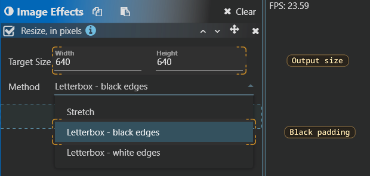

Worked pixel examples

### Shared input and HSV color operations

The source frame for comparing the color effects:

[Source card as SVG](/assets/wiki-media/m004-source.svg).

Both color examples use the same HSV range, limits **included**:

| Parameter | Value |
| --- | --- |
| H | 55–65 |
| S | 200–255 |
| V | 150–255 |
| Green card patch | RGB (0, 204, 0), HSV (60, 255, 204). |

These are the editor's H, S and V scales: H goes up to 180, S and V up to 255. They are not degrees or percentages. The range selects saturated green. Antialiased edges can fall outside it.

**Color Removal** paints the selected pixels black. The other colors still take part in the analysis.

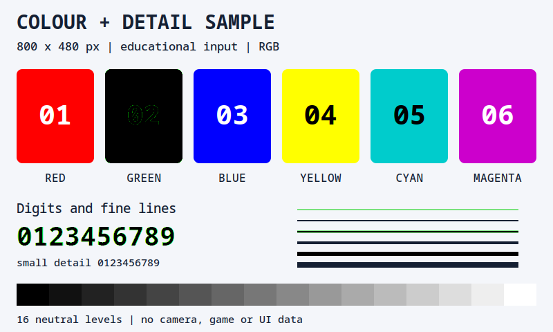

Invert is off. All **19,194** matching pixels became black, RGB (0, 0, 0). The other **364,806** pixels did not change.

**Color Replacement** gives a two-color mask. You set the color for matching pixels and for the rest separately.

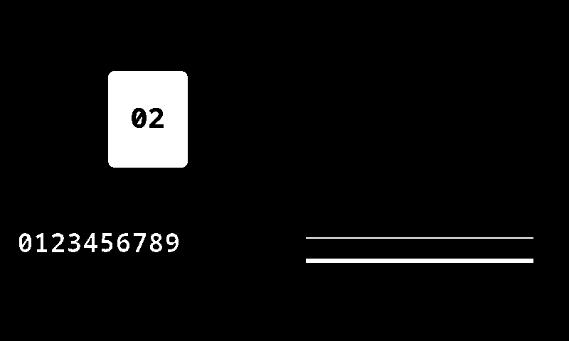

Both replacement switches are on and Invert is off. Matching pixels get white, RGB (255, 255, 255). Nonmatching pixels get black, RGB (0, 0, 0). The result has **19,194 white** and **364,806 black** pixels.

### Crop

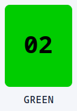

Cropped from the [shared card](/assets/wiki-media/m004.png): x = 144, y = 92, width = 128, height = 184. The result is exactly 128×184 pixels, and the colors were not recalculated. The coordinates belong to the image, not to the screen or the window. Crop, Resize, Grayscale, Negate and Gaussian Blur here were each calculated from the same card on their own, not as a chain.

### Denoise — compare noise and detail

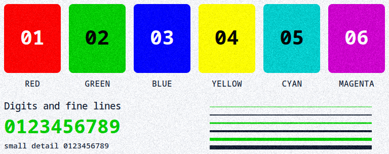

The 768×304 input is the card region x = 16, y = 92, width = 768, height = 304. The same Gaussian noise with σ = 12 was added to all three channels. Then the values were rounded and clipped to 0–255.

The result of `fastNlMeansDenoisingColored` with **Strength = 12**, **Template Window Size = 3**, **Search Window Size = 7** and the internal hColor = 3. Noise is weaker on flat areas, but some mottling remains and fine edges have changed.

### Dilate and Erode — the same mask, separate operations

Dilate widens bright features and Erode narrows them. Both results were calculated from the same [Color Replacement mask](/assets/wiki-media/m006.png), each on its own, with **Iterations = 1** and a **3×3 rectangular kernel** anchored at its center.

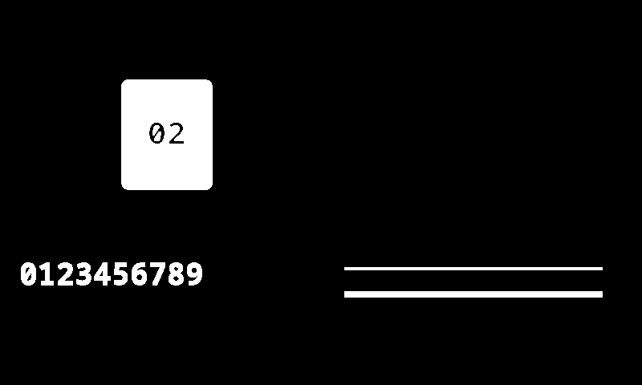

Dilate gives each pixel the maximum of its nine-pixel neighborhood, itself included. Pixels outside the image count as 0. White pixels grow from **19,194 to 22,696**. White strokes get wider and the black 02 digits get thinner.

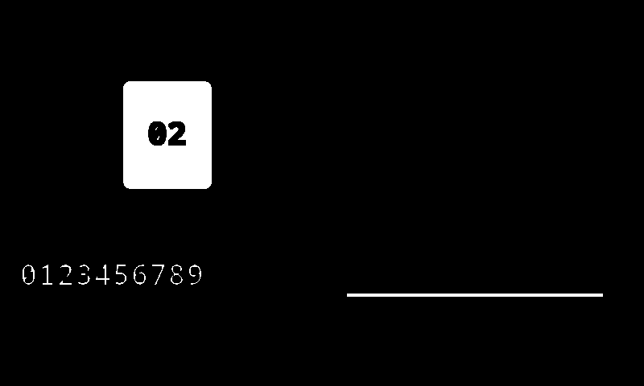

Erode gives each pixel the minimum of its nine-pixel neighborhood. Pixels outside the image count as 255. **15,751 white pixels** remain. The thin upper white line disappears, the lower one narrows, and the black 02 digits grow.

### Gaussian Blur

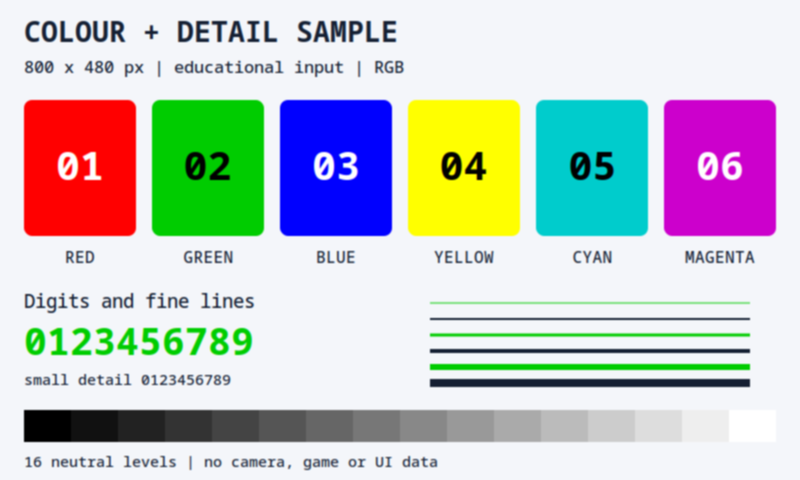

The 800×480 output uses **Kernel Size = 3** and sigma = 0, with weights **1/4, 1/2, 1/4** on each axis. Edges are extended with Reflect101, which does not repeat the boundary pixel. Values are rounded to nearest, half up. Fine edges become softer.

### Grayscale and Negate

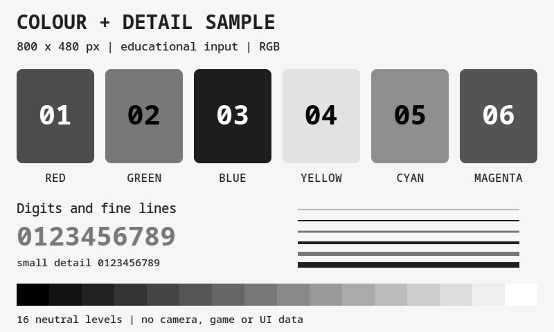

BGR → Gray → BGR. Each pixel gets the brightness `(3735·B + 19235·G + 9798·R + 16384) >> 15`, the same in all three channels. The red patch becomes gray level 76, green 120 and blue 29.

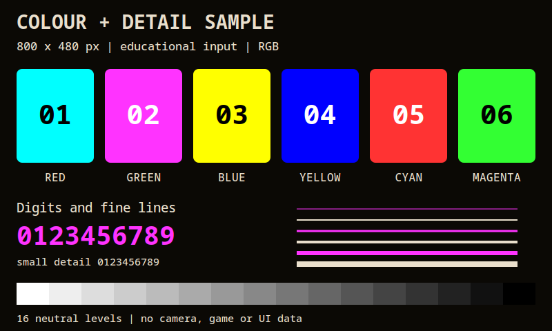

A bitwise NOT of each 8-bit channel, which is `255 − original value`. Red RGB (255, 0, 0) becomes cyan (0, 255, 255), and black becomes white.

### Resize with padding

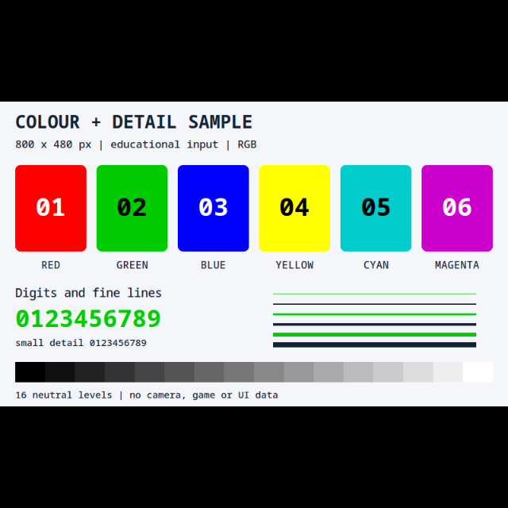

**Target Size = 640×640**, **Method — Letterbox - black edges**. A scale of 0.8 gives 640×384 content with 128 black rows above and below. The bilinear calculation uses pixel centers and rounds to nearest, half up.

### Binary Threshold comparison

The figure shows how different thresholding methods bring out digits on an unevenly lit page. The labels in the picture do not mean each method is a separate control in this effect. More thresholding examples: the [LearnOpenCV guide](https://learnopencv.com/opencv-threshold-python-cpp/) and an [introductory article](https://medium.com/@manik.butex41/an-introduction-to-thresholding-operations-in-opencv-64aff0cb2826).

Watch the load in **Effects time** in the preview FPS tooltip. The cost depends on the frame size and the chain, and every effect costs something. To change only the saved sample, use the [template editor](/en/triggers/images/image-editor) instead of effects on every frame.
