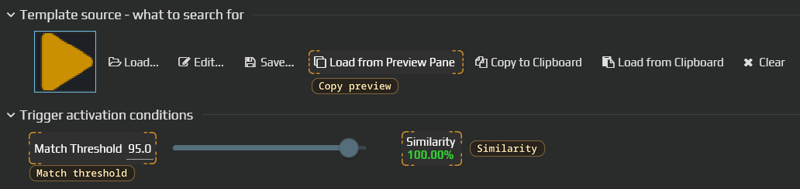

# Image Search — notice a familiar icon

Image Search looks for a familiar picture in a window. For example, the icon that shows an export has finished. You save it once as a **template**, and the trigger looks for a similar fragment in new frames.

You need a real icon on screen and a state where it is absent. Keep the interface scale, theme and icon size the same.

## Capture a template and check both states

1. Open the completed state in your application. Add **Image Search** to an aura.
2. Select the application's window under **Capture settings → Target Window**. Set **Image Capture Rate = 5** and expand **Preview captured image**. If the icon is not in the frame, fix the [capture](/en/triggers/images/imagecapturetriggers) first.
3. Use **Crop region** to keep only the place where the icon appears. Leave a little room for movement, but no similar neighbors.
4. In the preview, choose **w/o debug data**. Then, under **Template source - what to search for**, click **Load from Preview Pane**. This copies the whole preview image.
5. Click **Edit...**, use **Crop** to keep only the icon, then click **Save**. Leave out percentages, times and file names that change. Cleanup and transparency are covered in the [template editor](/en/triggers/images/image-editor).
6. Under **Trigger activation conditions**, set **Match Threshold = 95%** and click **Refresh Once**. Look at the actual **Similarity** and the found region. 95% is a starting value to test on your icon.
7. Switch the application to the state without the icon and refresh again. The match should disappear and the trigger become inactive. Bring the icon back and check that the match returns.

If a visible icon is missed, compare its scale and the frame with the sample. If it matches without the icon, narrow the region or choose a more distinctive template. Lowering the threshold lets more candidates through, including false matches.

## Template and result

| Control or value | Use |
| --- | --- |
| Load... | Loads a template from a file. A copy is stored inside the trigger. If you change the file later, the template does not update. |
| Load from Preview Pane | Takes the current preview. Trim it with Edit... afterwards. |
| Load from Clipboard / Copy to Clipboard | Moves the template image through the clipboard. |
| Edit... / Save... / Clear | Edits the embedded sample, saves it to a separate file, or removes it. |
| Transparent sample pixels | Left out of the comparison. Remove a background or a changing corner and keep the distinctive part of the icon. |
| Match Threshold | The minimum similarity. If the result is not below the threshold, the trigger is active. |
| Similarity | The actual similarity of the found candidate. |

The search does not fit the template to a rotation or a different scale. Prepare a separate sample for another size. [AI Search](/en/triggers/images/ai-search-trigger) does a different job. It finds classes a model was trained on, not any icon you load into Image Search.

Several matches and diagnostic outlines

| Setting | Effect |
| --- | --- |
| Match Collection → Include All Matches | Collects several matching results instead of only the best one. |
| IoU Threshold | Removes overlapping results. It does not replace Match Threshold. |
| On-screen-display → Window / Region / Bounding Boxes | Draws the window, the capture region and the boxes of found fragments on screen for diagnosis. |

For “at least one icon is present”, the normal single-result search is enough. Even a frame with no match can take a lot of work, so keep the region small.

A result rectangle belongs to the captured and processed image. Cropping and scaling change how it maps to the screen, so do not use a preview pixel as a desktop click position. Set up the [coordinate system](/en/features/coordinate-system) and any input target separately.

To keep the found area in view, use [Replica](/en/overlays/replica) and link this search aura as its source. Check the found rectangle first. Replica shows that region and does not send input to the source window.

Once both states work, add an action to the aura's **OnEnter**, such as [Play Sound](/en/actions/play-sound). If this is the only trigger in the aura, the sound plays once when the icon is found, not on every frame.
