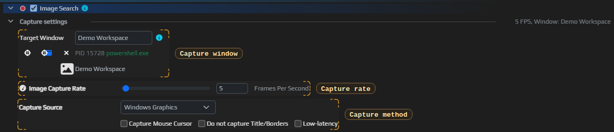
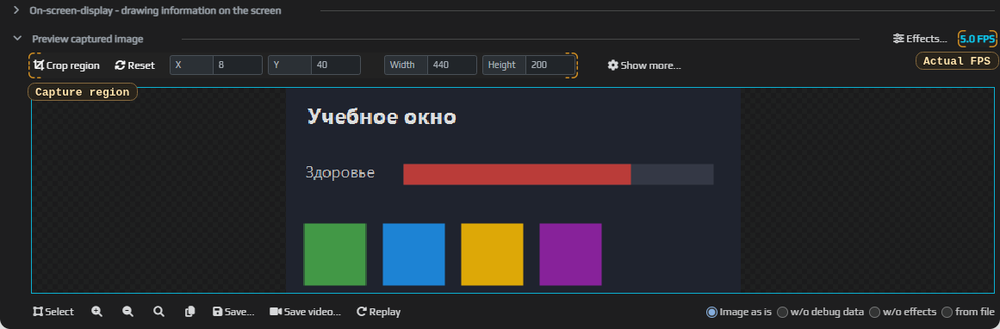

# Capture the right pixels before searching

Before EyeAuras can search for an icon, color or text, it needs a picture of the right part of the window. Open the trigger preview and check what it sees. If the frame is black, shows a neighboring window or covers too large an area, the search will not work, whatever threshold you set.

Image Search, Color Search, Text Search and AI Search share these settings.

## Capture one changing indicator

Say you want to watch a small indicator in an application. First get the preview to show only that indicator, without the rest of its panel.

1. Open the application so that the indicator is visible. Add a trigger to an aura, for example **Color Search**.
2. Under **Capture settings → Target Window**, select the application window. The selected window is shown below the expression. If several windows match, narrow the choice with a [matching expression](/en/features/window-matching-expressions).
3. Set **Image Capture Rate = 5 Frames Per Second**. That is enough for a mostly static indicator, and you can change it later.
4. Expand **Preview captured image**. If the frame is empty or wrong, click **Show more...** and check **Capture Source**. Start with **Windows Graphics** if it is available. If that does not help, try the other sources from the table below.
5. Set **Crop region → X, Y, Width, Height** so that only the indicator stays in the frame. The values are counted from the selected source image, so go by the preview, not by where the window sits on the desktop. **Reset** removes the crop.
6. Change the indicator in the application. The same spot should change in the preview. Only then pick the color, sample or text to search for.

## Capture settings

| Setting | Why change it |
| --- | --- |
| Target Window | Where the pixels come from. If several windows match, narrow the expression. |
| Image Capture Rate — formerly Max FPS | How often to capture and analyze a frame. 5 FPS is roughly one check per 200 ms, 30 FPS one per 33 ms. |
| Settings → Max Capture FPS | Shared rate limit. It can cut a trigger's own rate, and the editor then shows MAX … FPS. |
| Crop region | The area to analyze. A smaller area usually means less work and fewer stray matches. |
| Capture Mouse Cursor | Adds the cursor to the frame if the source supports it. For a static icon it is usually better left out. |
| Do not capture Title/Borders | Removes the title bar and borders where the source supports it. Recheck the crop afterwards. |
| Low-latency | Changes how frames are acquired. Check the frame and the load on your own application. |
| Effects... | Processes the frame before analysis, for example resizes it or turns it grayscale. |

The measured FPS is shown next to the preview. Hover over it: the tooltip lists capture, effects and processing time separately, plus the age of the last frame and the output size. If processing takes 100 ms, asking for 30 FPS will not make it take 33 ms. First reduce the region, turn off effects you do not need or lower the rate. Preview zoom only changes how you see the image. Crop and resize effects change the actual pixels and their coordinates.

## Choose a capture source

Which sources are available depends on Windows, the graphics components and the application itself. First check that the frame is right, then compare the load.

| Capture Source | When to try it |
| --- | --- |
| Windows Graphics | System window capture. Needs Windows 10 build 19041 or later and a supported Graphics Capture session. |
| Shared Surface | Takes the window surface through the graphics subsystem. A fallback if Windows Graphics gives a wrong frame. |
| Desktop duplication | GPU desktop capture. Overlapping windows can end up in the selected area. |
| Print Window | Older window capture. Hardware-rendered applications may return a blank or incomplete image. |
| Copy Device Context | Copies the window context through GDI. For ordinary compatible windows. |
| Copy From Screen | Copies visible screen pixels. Window position and overlapping windows matter. |

After switching sources, check the region and the frame again. Do not expect fresh pixels from a closed, minimized or inaccessible window. If capture or processing fails, the trigger can become Unknown instead of reporting a normal no-match.

Preview, one-shot checks and older Min FPS configurations

| Control | Meaning |
| --- | --- |
| Refresh Once in a search editor | Runs one check. Handy during setup, when you do not need a high continuous rate. |
| MIN … FPS (only in Preview) | Minimum rate while the preview is open. It can be higher than the trigger's own rate, so close the preview when you measure normal load. |
| Image as is / w/o debug data / w/o effects | Show the frame with annotations, without debug marks and without effects. |
| from file | Puts an image from a file into the preview. Switch back to the normal source afterwards. |
| Older Min FPS | Used to describe how long a result stayed valid before the trigger went Unknown. The current editor has no such field, so do not count on a saved value as a freshness timer. |

If a search is needed only in one mode, set [Enabling Conditions](/en/features/enabling-conditions) on the aura or its folder. An ordinary trigger that is false does not stop the other capture and search triggers.

Once the source and region are ready, continue with [Image Search](/en/triggers/images/image-search), [Color Search](/en/triggers/images/color-search), [Text Search](/en/triggers/images/text-search) or [AI Search](/en/triggers/images/ai-search-trigger). If the pixels themselves need changing before analysis, add [Effects](/en/triggers/images/effects).
