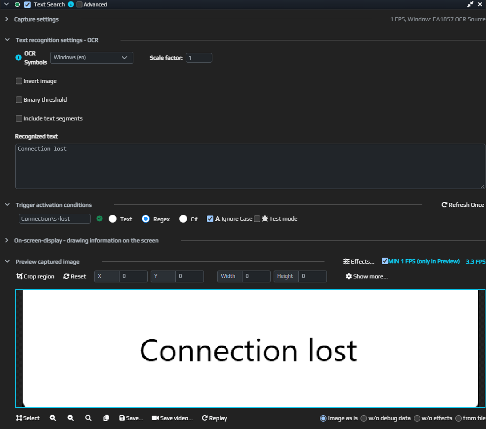
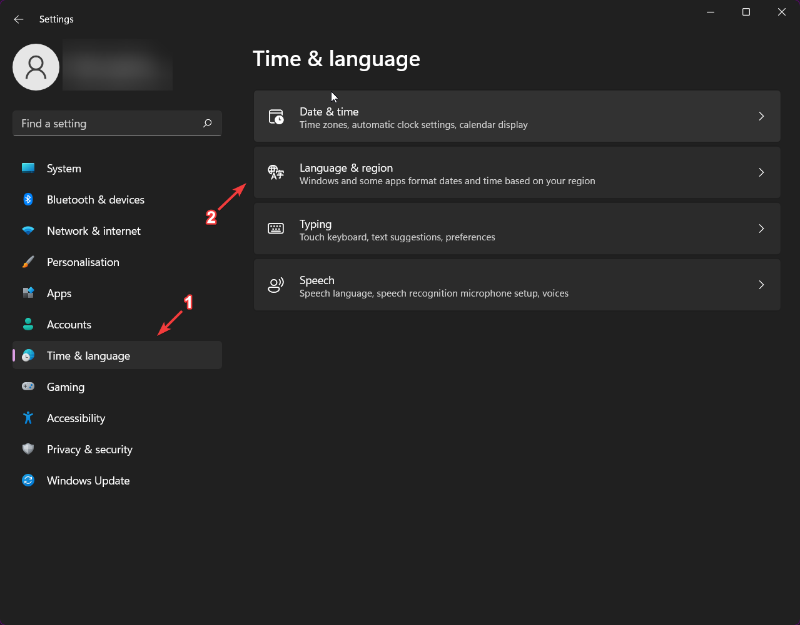
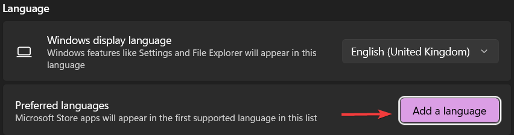
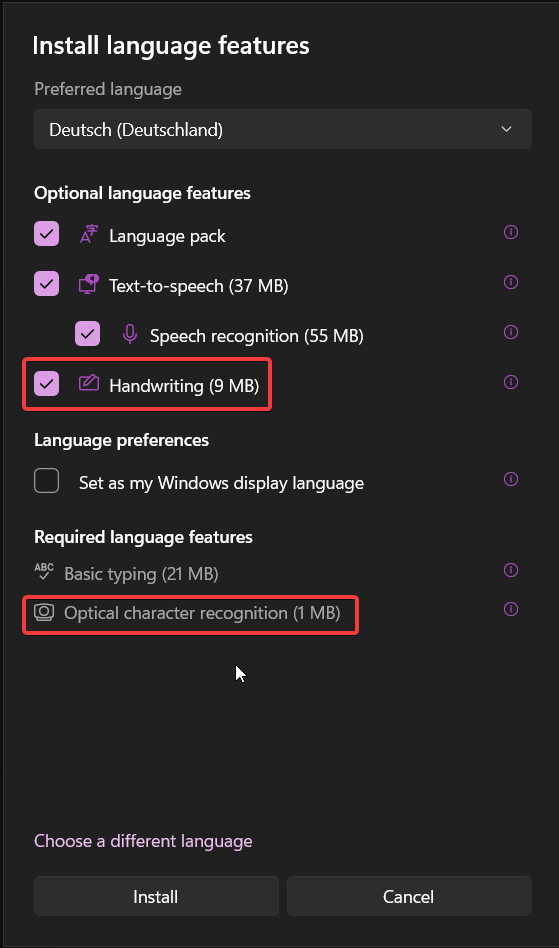

# Text Search — react to visible text

Read `Connection lost` from an image of your own window, then use the result as an aura condition. This image-to-text step is OCR. First make the recognized text correct; add a reaction only afterwards. The trigger reads pixels, not a game's internal connection or health state.

You need working [capture](/en/triggers/images/imagecapturetriggers), an available OCR engine for the text's language, and your own stable test window displaying the phrase clearly. Start without actions.

## Recognize one phrase

1. Add **Text Search** to a separate aura and choose your own window under **Capture settings → Target Window**. Keep the aura loaded and available for capture.
2. Select a small region containing the phrase. Expand **Preview captured image** and check that its letters are visible. Start at **1 Frames Per Second**, **Scale factor = 1**, with **Invert image**, **Binary threshold** and **Include text segments** off.
3. Under **Text recognition settings - OCR → OCR Symbols**, choose an available English engine, such as **Windows (en)** or **Tesseract (eng)**. A saved name does not make an unavailable engine work.
4. Click **Refresh Once** and inspect **Recognized text**. Resolve capture or language errors before relying on the condition.
5. Under **Trigger activation conditions**, select **Regex**, enter `Connection\s+lost`, and enable case-insensitive comparison. `\s+` permits spaces or a line break between the words.
6. Show and remove the phrase in your own window, refreshing as needed. When recognition supplies the phrase, the expression matches and the trigger becomes Active. When the evaluated string no longer matches, it becomes Not Active.

This existing real example shows a normal window containing the phrase: the captured image is below and **Recognized text** contains the read string. Its expression matches. It illustrates that configured case, not recognition of every font, language or application. Repeat the check at the actual size and display scale you intend to use.

| Setting | What it controls |
| --- | --- |
| Capture window and region | Pixels supplied to OCR. Start with a small area without unrelated text. |
| `OCR Symbols` | Available engine/language combination. Windows entries come from installed OCR languages; Tesseract entries depend on loadable data files. |
| `Text` / `Regex` / `C#` | Tests the entire recognized string through [Text Match Expressions](/en/features/text-match-expressions). `C#` uses the Lambda evaluator and its expression context, not top-level script globals. It is not an image-search confidence threshold. |
| `Scale factor` | Resizes the grayscale OCR image, from 0.1 to 5 in the current editor. Keep 1 initially; larger is not always better. |
| `Invert image` | Swaps light and dark before OCR. Compare it for light text on a dark background. |
| `Binary threshold` | Applies an automatic Otsu black/white threshold after resizing. This checkbox is not a manually entered threshold value. |
| `Include text segments` | Requests engine-specific text regions and scores, mainly for scripts or preview inspection. It is not required for matching a phrase. |

To add a notification, put **Play Sound** in **On Enter**. It runs when the aura becomes active; [Send To Telegram](/en/actions/send-telegram-message) is another configured reaction. Other aura triggers also affect the final activity state. Recognition or a state change alone does not execute a click.

For a persistent visible indicator instead of a one-shot sound, add [Text](/en/overlays/text) with your own message to this aura. It follows the aura’s activity; [Common Options](/en/overlays/common-options) explains locking and normal visibility checks outside the editor. Content remains the words you enter, rather than an automatic binding to Recognized text.

## Separate a mismatch from unavailable recognition

| State or observation | Meaning |
| --- | --- |
| Active | The evaluated recognized text matches the expression. |
| Not Active | The expression was evaluated and did not match that string. It does not prove what was visible in every frame. |
| Unknown | A result could not be computed, for example with no image, an unavailable engine or a processing exception. Read its annotation/error. |
| Empty Recognized text | Inspect the image and engine result. Some engine failures can return an empty result; emptiness alone is not proof that the phrase was absent or that the state must be Unknown. |

Wrong letters call for capture, language or image adjustments. Correct words without a match call for expression changes. Change one setting at a time and compare with **Refresh Once**. Dark text on a bright background is a useful starting point, not a guarantee. [Image Effects](/en/triggers/images/effects) can prepare pixels; avoid removing parts of letters while increasing contrast or scaling small text.

Language setup and the earlier Windows illustrations

Choose from **OCR Symbols** in your installed build rather than assuming a fixed set of four bundled models. Windows OCR requires Windows OCR support and that language's OCR capability. Microsoft documents [Language.OCR Features on Demand](https://learn.microsoft.com/en-us/windows-hardware/manufacture/desktop/features-on-demand-language-fod?view=windows-11); handwriting and OCR are separate capabilities.

The earlier Windows 10 route was **Settings → Time & Language → Language**, followed by adding the preferred language and opening its **Options**. Windows versions can arrange these controls differently. Ensure the language's OCR capability is installed, then restart EyeAuras so engines are enumerated again.

[Tesseract](https://github.com/tesseract-ocr/tesseract) uses `.traineddata` files. EyeAuras looks for `tessdata` under its roaming app-data directory, app-data directory, application base directory and OpenCV module directory. The old `%appdata%\release\tessdata` location is not a universal path for every installation. Compatible language data is available from [tessdata_best](https://github.com/tesseract-ocr/tessdata_best); restart the application after preparing it. Do not mix files with an incompatible installed engine.

Where the data loads successfully, entries can include `Tesseract (eng)`, `Tesseract (rus)` and combined `eng+rus`. `Tesseract (numbers)` uses English data with a digits/decimal-separator whitelist, rather than a separate guarantee of reading every numeric format. Windows languages are likewise limited to those available to its OCR service. Neither engine is universally more accurate than the other.

Text regions, scores and coordinates

The text expression is tested against the whole recognized string. A successful trigger's match bounds cover the supplied capture image; they are not automatically a tight box around just the regex phrase. With **Include text segments**, the current engines expose word regions. Windows supplies a score of 1 for each word here; Tesseract exposes its own normalized confidence. These are not interchangeable calibrated probabilities.

Segment regions belong to the processed OCR image. Scaling changes that coordinate space; do not treat the coordinates as desktop pixels or apply a capture-to-screen conversion twice. Start at Scale factor 1, then use the actual result/capture coordinate contracts for scripts. Preview region boxes and the **On-screen-display** `Window` / `Region` controls help inspect the source; they do not by themselves send input.

Health numbers, inventory text, chat phrases, dialogue options, quest or achievement notices can supply conditions only when those words are actually visible and recognized. OCR does not expose a hidden game state or configure the reaction automatically. For accessibility or alerts, verify the text and condition first, then configure your intended action separately.

