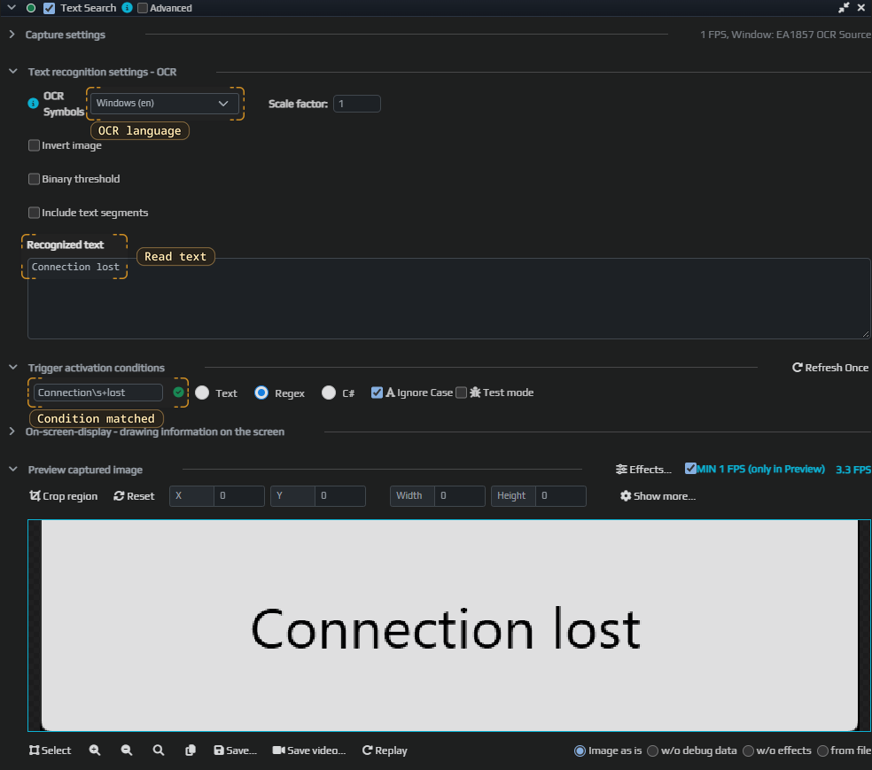
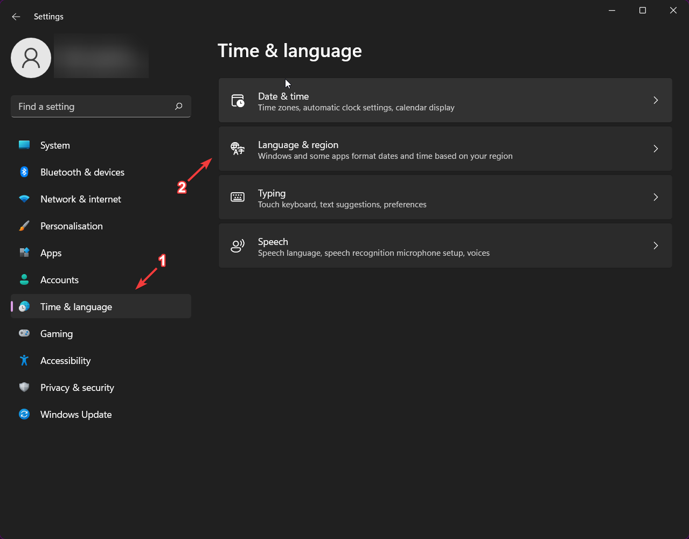
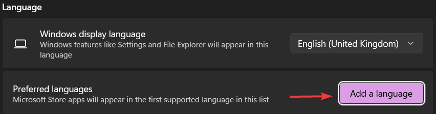
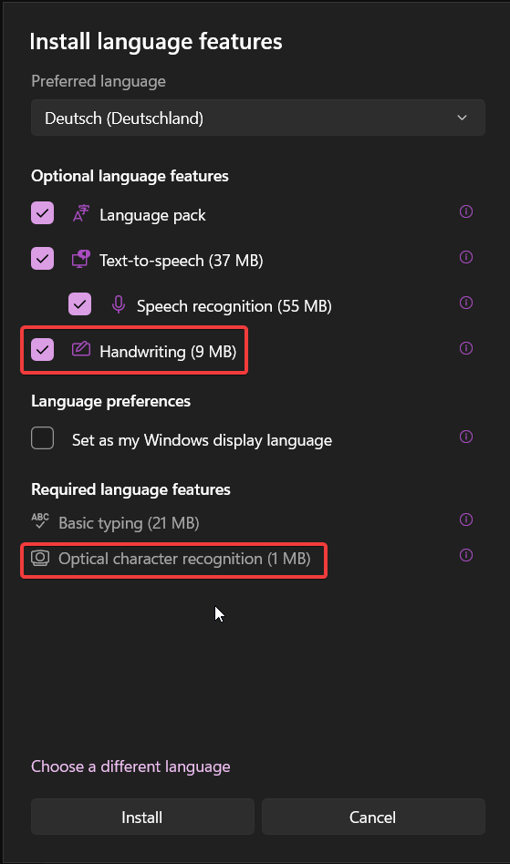

# Text Search — react to visible text

Text Search reads text from a picture of the selected region and checks it against your condition. For example, `Connection lost` appears in an application and you get a notification right away. Reading text from a picture is called OCR.

## Recognize one phrase

1. Add **Text Search** to a separate aura and choose the application window under **Capture settings → Target Window**.
2. Select a small region where the phrase appears. Expand **Preview captured image** and check that the letters are visible. Start with **1 Frames Per Second** and **Scale factor = 1**, and leave **Invert image**, **Binary threshold** and **Include text segments** off.
3. Under **Text recognition settings - OCR → OCR Symbols**, choose an available engine for the language of the text. In this example that is English, such as **Windows (en)** or **Tesseract (eng)**.
4. Click **Refresh Once** and look at **Recognized text**. If you see an error or an empty line instead of words, fix capture and recognition first.
5. Under **Trigger activation conditions**, select **Regex**, enter `Connection\s+lost` and turn on case-insensitive comparison. `\s+` allows spaces or a line break between the words.
6. Show and remove the phrase in the window, refreshing as needed. The trigger becomes Active when the recognized text matches and Not Active when it no longer does.

A plain window with the phrase typed in is fine for a first try. Then repeat the check in the real application at its usual size and display scale.

## Add a reaction

Put **Play Sound** in **On Enter** of this aura. The sound plays when the recognized text first matches and the aura becomes active. Instead of a sound you can set up [Send To Telegram](/en/actions/send-telegram-message).

Need a permanent indicator on screen instead of a one-shot sound? Add a [Text](/en/overlays/text) overlay with your own message to this aura. It is shown while the aura is active. Content keeps the words you typed: the recognized text does not get there on its own. Locking the overlay and checking its normal visibility outside the editor are covered in [Common Options](/en/overlays/common-options).

## Settings

| Setting | What it controls |
| --- | --- |
| Capture window and region | Where to look for the text. Start with a small area without unrelated text. |
| `OCR Symbols` | Engine and language. Windows entries come from installed OCR languages. Tesseract entries depend on data files that can be loaded. |
| `Text` / `Regex` / `C#` | What counts as a match. The whole recognized string is tested through [Text Match Expressions](/en/features/text-match-expressions). `C#` uses the Lambda evaluator and its expression context, not top-level script globals. |
| `Scale factor` | Resizes the grayscale image before OCR, from 0.1 to 5 in the current editor. Start with 1. A larger value can help with small letters but is not always better. |
| `Invert image` | Swaps light and dark before OCR. Try it for light text on a dark background and compare the result. |
| `Binary threshold` | Makes the image black and white after resizing, using an automatic Otsu threshold. You do not enter a value. Check that no parts of letters disappear. |
| `Include text segments` | Adds per-word regions and scores, mainly for scripts or preview inspection. Not needed to match a phrase. |

## If the text is not found

| State or observation | Meaning |
| --- | --- |
| Active | The text was recognized and matches the expression. |
| Not Active | The check ran and there was no match. |
| Unknown | No result could be computed, for example there is no image, the engine is unavailable or processing failed. Read the annotation or error. |
| Empty Recognized text | Check the image and the engine result. Some engine failures return an empty result, so an empty string alone does not show that the phrase was absent. |

Look at the recognized string. If the letters are wrong, the problem is capture, language or image processing. If the words are right but there is no match, the problem is the expression. Change one setting at a time and compare with **Refresh Once**. Dark text on a bright background is a good starting point. [Image Effects](/en/triggers/images/effects) can prepare the pixels. Take care not to lose parts of letters when you raise contrast or scale small text.

The shared capture settings are described [separately](/en/triggers/images/imagecapturetriggers).

Language setup for Windows OCR and Tesseract

Choose from the **OCR Symbols** list in your installed build. The set of engines is not fixed. Windows OCR needs Windows OCR support and the OCR capability for that language. Microsoft describes it in [Language.OCR Features on Demand](https://learn.microsoft.com/en-us/windows-hardware/manufacture/desktop/features-on-demand-language-fod?view=windows-11). Handwriting and OCR are separate capabilities.

In Windows 10 the path was **Settings → Time & Language → Language**: add the language, then open its **Options**. Other Windows versions may arrange this differently. Make sure the language's OCR capability is installed, then restart EyeAuras so that it lists the engines again.

[Tesseract](https://github.com/tesseract-ocr/tesseract) uses `.traineddata` files. EyeAuras looks for a `tessdata` folder under its roaming app-data directory, app-data directory, application base directory and OpenCV module directory. The old `%appdata%\release\tessdata` path does not apply to every installation. You can get language data from [tessdata_best](https://github.com/tesseract-ocr/tessdata_best). Restart the application after adding it. Do not use files that are incompatible with the installed engine.

When the data loads, the list can include `Tesseract (eng)`, `Tesseract (rus)` and the combined `eng+rus`. `Tesseract (numbers)` uses English data with a whitelist of digits and decimal separators. Windows languages are limited to those available to its OCR service. Neither engine is always more accurate than the other.

Text regions, scores and coordinates

The expression is tested against the whole recognized string. When the trigger matches, its match bounds cover the whole captured image, not a tight box around the phrase. With **Include text segments**, the current engines return word regions. Windows gives every word a score of 1. Tesseract returns its own normalized confidence. The two scores cannot be compared directly.

Segment regions belong to the processed OCR image. Scaling changes those coordinates, so they are not desktop pixels, and a capture-to-screen conversion must not be applied twice. Start at Scale factor 1, and in scripts follow the coordinate rules of the actual result and capture. Preview region boxes and the **On-screen-display** `Window` / `Region` controls help you inspect the source. They do not send input.

Health numbers, inventory text, chat phrases, dialogue options, quest or achievement notices can all serve as conditions, as long as the words are visible on screen and recognized. OCR does not see hidden game state.

