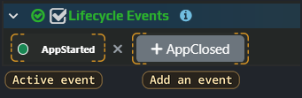

# Show that EyeAuras has started

**Lifecycle Events** remembers events from EyeAuras itself. For example, with **AppStarted** you can show “EyeAuras ready” once the application window has loaded.

1. Create an aura with a **Lifecycle Events** trigger.
2. Click **+ AppStarted**. If EyeAuras has already reported startup in this session, the event becomes active right away. You do not need to restart the application to check.
3. Add a [Text overlay](/en/overlays/text) with the text `EyeAuras ready`, visible while the aura is active. Turn off forced editor preview.
4. Look at AppStarted and the text. If **Pause Everything if Active** is enabled, the reaction may wait until EyeAuras loses focus (see below). Then remove the subscription with the cross next to the event: with no events selected, the trigger becomes **Unknown**. Add AppStarted again and the event that already happened counts right away.

The tooltip of a selected event shows when it fired, or **Not triggered yet**.

## Events and state

| Event or state | Meaning |
| --- | --- |
| AppStarted | EyeAuras reports that its window has loaded. Good for a reaction to EyeAuras starting |
| AppClosed | EyeAuras reports that its window is closing, before the rest of shutdown |
| Active | At least one selected event has happened during this EyeAuras run |
| Inactive | Events are selected but none has happened yet |
| Unknown | No event selected |
| Multiple subscriptions | Any one of them is enough. For separate startup and shutdown reactions, use separate auras |

The result is kept, not pulsed. If you subscribe after the event has happened, it still counts, as long as it is the same application run.

To run an action instead of showing text, put it in **On Enter**. AppClosed does not enter the aura again if it is already active because of AppStarted. Do not hang a long send or save that must finish on the shutdown event.

To watch for another application's window, use [Window Exists](/en/triggers/window-exists): AppStarted is only about EyeAuras. If you run an action on startup, check its messages and errors in [Event Viewer](/en/features/event-viewer) before you count the work as done.

The event is active but its reaction is paused

Check the **Pause Everything if Active** setting. It pauses auras and trees while the main EyeAuras window or its overlays are active. The startup event may already have happened, but the pause holds the reaction back.

Usually it is enough to remember this pause and check the reaction after moving focus away from EyeAuras. Turning the option off changes how every aura works, so do not turn it off just because one action did not run.

In a Pack that you distribute, the same behavior is set in **Packing configuration**. Choose the policy you want and check it before you distribute.

