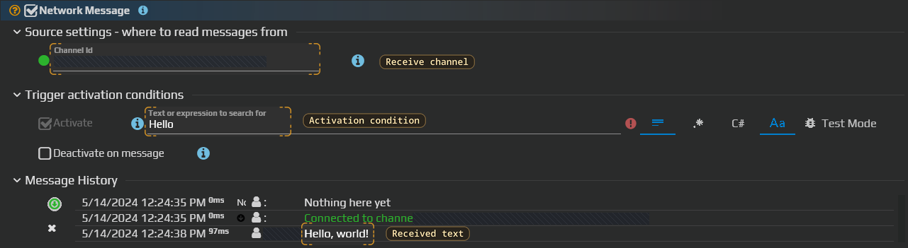
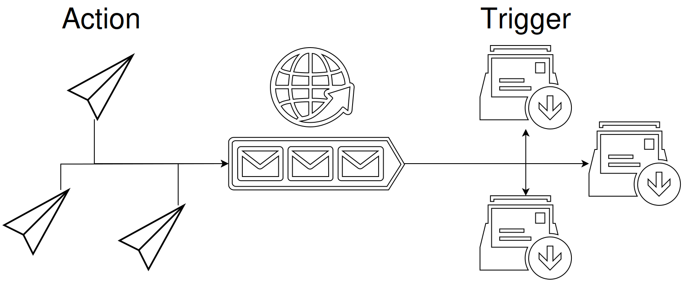
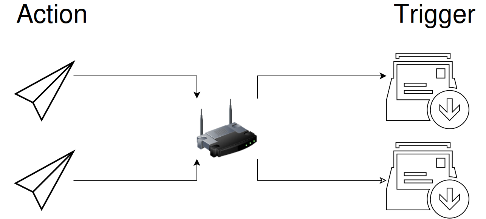

# Keep a state from channel commands

**Network Message** receives EyeAuras messages and checks their text against a condition. For example, the `review` command shows “Review in progress” and `done` hides it.

Start with two auras in one EyeAuras instance. The **local://review-status** channel needs no network and no second computer.

1. Add **Network Message** to the receiving aura. Under **Source settings - where to read messages from → Channel Id**, enter **local://review-status**.
2. Set **Activate → Regex** to `\Areview\z`.
3. Enable **Deactivate on message**, choose **Regex** for the condition that appears and enter `\Adone\z`. Turn off **Test mode** for both conditions.
4. Add a [Text overlay](/en/overlays/text) with the text `Review in progress` to this aura. It should be visible only while the aura is active. Turn off forced editor preview, because it hides the real visibility.
5. In another aura, add two [Send Network Message](/en/actions/send-network-message) actions with the same Channel Id. Set **Message text** to `review` for the first and `done` for the second.
6. Run the first action with **Execute**. The message appears in the receiver's **Message history**, the trigger becomes active and the text shows. Run the second: the trigger becomes inactive and the text disappears. A `report` message matches neither condition and does not change the state.

## Understand the state lifetime

| Setting | Result |
| --- | --- |
| Activate | A matching message activates an inactive or not-yet-set trigger. An empty expression matches any accepted message |
| Deactivate on message enabled | The trigger stays active until a message matches the deactivation expression. In this example that is `done` |
| Deactivate on message disabled | The trigger asks to deactivate about 50 ms after activation. This is a short signal, not a stored flag |
| Empty deactivation expression | Matches any message, so the next accepted message can switch an active trigger off |
| Text / Regex / C# | [Text-matching modes](/en/features/text-match-expressions), with Ignore Case and Test mode |
| Message history / Clear history | Recent incoming messages and clearing the list. Clearing the list does not reset the trigger state |

Not every history row is a new switch to Active. If the trigger is already active and has a separate `done` condition, another `review` changes nothing and **On Enter** does not run again. A disabled receiver does not queue missed messages or replay them later.

This is a server channel. The local:// example above does not use it. [Original source SVG](/assets/wiki-media/m077-original.svg).

## Receive from another computer

| Channel Id | Requirement |
| --- | --- |
| The same server-channel name or eye:// address | Both EyeAuras instances are connected to the EyeAuras message server and signed in |
| Receiver broadcast://255.255.255.255:55055/review-status | An available UDP port 55055 on the local network |
| Sender broadcast://192.168.0.21:55055/review-status | Replace .21 with the receiver's real IP. The channel path and port must match the receiver |
| No explicit port | 53082 is used. Pick a custom port from 49152–65535 and change it on both sides |

Broadcast, multicast, VM networking and a full two-computer setup are covered in the [sending guide](/en/actions/send-network-message).

[Source SVG](/assets/wiki-media/m016-restored.svg).

On a LAN, EyeAuras sends UDP packets in Protobuf format, not plain text, JSON or arbitrary HTTP/TCP requests. No message server is needed, but everything depends on the network: there is no delivery confirmation and no fixed latency. Listening on 255.255.255.255 still filters by the exact channel path and query. It does not receive every command on the network.

Server channels use the application's shared connection and sign-in. This trigger has no login field of its own. Keep channel identifiers private: there is no list of allowed senders. The trigger does not reply to messages. For a reply, add a separate sending action.
