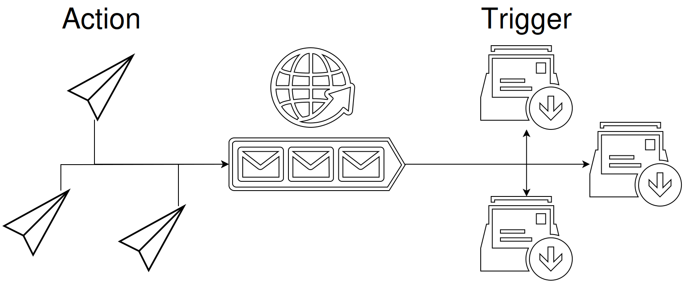
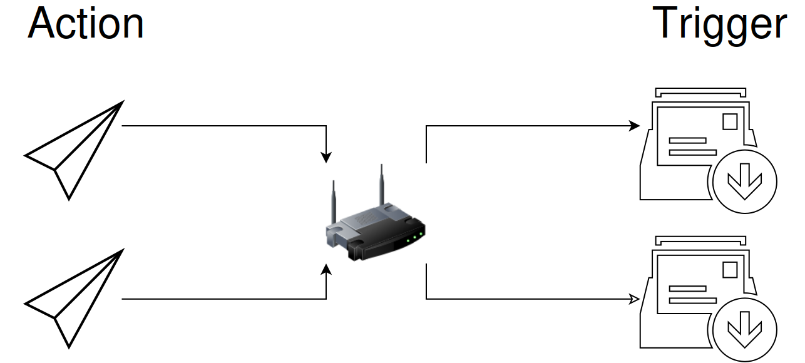

# Keep a state from channel commands

**Network Message** receives EyeAuras messages and tests their text. A `review` command can show “Review in progress”, while `done` hides it. The trigger stores the state; an overlay or action supplies the reaction separately.

Start with two auras in one EyeAuras instance. **local://review-status** needs no second computer or network connection.

1. Add **Network Message** to the receiving aura. Under **Source settings - where to read messages from → Channel Id**, enter **local://review-status**.
2. Set **Activate → Regex** to `\Areview\z`.
3. Enable **Deactivate on message**, choose **Regex** for its condition and enter `\Adone\z`. Turn off **Test mode** for both conditions.
4. Add a [Text overlay](/en/overlays/text) containing `Review in progress`, visible while the aura is active. Turn off forced editor preview so it does not hide the real visibility condition.
5. In another aura, add two [Send Network Message](/en/actions/send-network-message) actions with the same Channel Id. Set their **Message text** to `review` and `done` respectively.
6. Use **Execute** on the first action. Its message should appear in the receiver's **Message history**, the trigger should become active and the text should show. Execute the second: the trigger should become inactive and the text disappear. An unrelated `report` message matches neither condition and leaves the stored state unchanged.

## Understand the state lifetime

| Setting | Result |
| --- | --- |
| Activate | A matching message activates an inactive or not-yet-set trigger. An empty expression matches any accepted message |
| Deactivate on message enabled | Keeps the active state until the deactivation expression matches; `done` in this example |
| Deactivate on message disabled | Requests automatic deactivation about 50 ms after activation. This is a short signal, not a latched flag; aura state processing also affects what is visible |
| Empty deactivation expression | Matches any message, rather than a specific `done` command; the next accepted message can switch an active trigger off |
| Text / Regex / C# | [Text-matching modes](/en/features/text-match-expressions), with Ignore Case and Test mode |
| Message history / Clear history | Recent incoming messages and list clearing. Clearing the list does not reset the trigger state |

A history row is not necessarily another transition to Active. Repeating `review` while already active with the separate `done` condition does not run **On Enter** again. Before a suitable message arrives, that command has not supplied a result. A disabled receiver does not queue missed messages for later playback.

The server-channel diagram shows sending actions on the left, a shared channel in the middle and subscribed triggers on the right. Each receiver evaluates its own text conditions.

The arrows run from Action through the channel to Trigger. The first local:// exercise does not use this server. [Original source SVG](/assets/wiki-media/m077-original.svg).

## Receive from another computer

| Channel Id | Requirement |
| --- | --- |
| The same server-channel name or eye:// address | Both EyeAuras instances need their configured server message connection and signed-in session |
| Receiver broadcast://255.255.255.255:55055/review-status | An available UDP port 55055 in the intended local network |
| Sender broadcast://192.168.0.21:55055/review-status | Replace .21 with the real receiver IP. The channel path and port must match |
| No explicit port | Uses 53082; custom ports should be within 49152–65535 and changed at both ends |

For broadcast, multicast, VM networking and a complete peer setup, use the [sending guide](/en/actions/send-network-message).

This LAN illustration retains the original diagram's senders, network device and receivers. The source is a repaired derivative, not a byte-exact original. [Repaired source SVG](/assets/wiki-media/m016-restored.svg).

LAN uses EyeAuras Protobuf UDP packets rather than plain text, JSON or arbitrary HTTP/TCP endpoints. It avoids the message server but still depends on the network, with no acknowledged delivery or fixed latency. Listening at 255.255.255.255 still filters the exact channel path and query; it is not a subscription to every command.

Server channels use the application's shared hub connection and authentication, not a separate login field in this trigger. Keep channel identifiers private: there is no per-channel sender allowlist in this editor. The connection badge alone does not prove receipt; look for the actual message in history. A reply requires a separate sending action—the trigger does not generate one.
