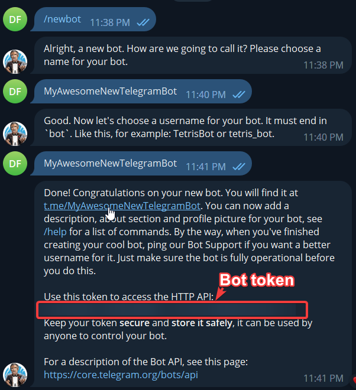
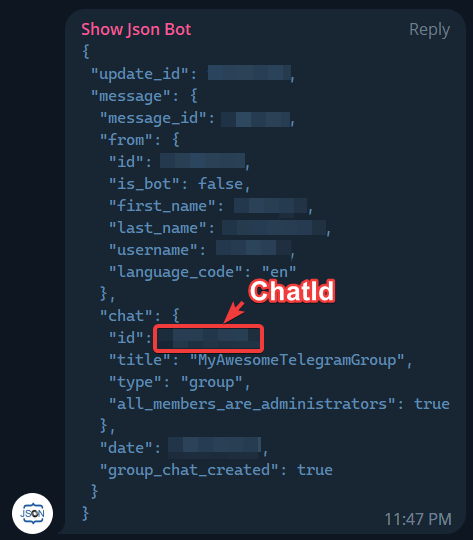

# Show a state from a Telegram message

**Telegram Message** reads new incoming messages sent to your bot. For example, `review` in a private chat shows “Review in progress” and `done` hides it.

You need Telegram, access from EyeAuras to the Bot API and a bot of your own. Start by writing to the bot in a private chat. Sending notifications through [Send To Telegram](/en/actions/send-telegram-message) is a different task and does not test incoming messages.

## Prepare your own bot

1. Open the official [@BotFather](https://t.me/BotFather) and send `/newbot`. It asks for a display name and a unique username that must end in `bot`. Details are in [Telegram's BotFather guide](https://core.telegram.org/bots/features#botfather).
2. Keep the token private. It gives control of your bot, so do not show it in screenshots, shared auras or support messages.
3. Open a private chat with your bot and press **Start**. The bot may not reply, and that is fine: EyeAuras only reads messages and no auto-reply is set up here.

## Receive two commands

1. Add **Telegram Message** to an aura and paste your token into **Telegram Bot Token**. Leave **Chat Id (optional)** empty for now so that you can find your chat's identifier. Do this with a separate bot that only you are writing to.
2. Wait until it connects, then send the bot a **new** message from your own account, for example `my chat`. A message sent before connecting will not do: the trigger skips the first batch of old updates.
3. Find the entry in **Message history**, click **Copy Chat ID to clipboard** next to it and paste the value into **Chat Id (optional)**. Now the trigger accepts only that chat.
4. Set **Activate → Regex** to `\Areview\z`. Enable **Deactivate on message** and set its **Regex** to `\Adone\z`. Turn off **Test mode** for both conditions.
5. Add a [Text overlay](/en/overlays/text) with the text `Review in progress` to the same aura, visible while the aura is active. Turn off forced editor preview.
6. Send `review` to the bot from your account. When the entry shows up in history, the trigger becomes active and the text appears. Send `done`: the trigger becomes inactive and the text hides. If the message is in history but the state does not change, check the conditions, not the token.

| Setting | Meaning |
| --- | --- |
| Telegram Bot Token | Your bot's token. EyeAuras uses it to receive updates |
| Chat Id (optional) | The exact chat identifier, including the minus sign if there is one. An empty field lets in every chat available to the bot, not just yours |
| Proxy server (optional) | SOCKS5 proxy as host:port or username:password@host:port. Leave it empty if you do not need one |
| Activate | Activation condition on the incoming text. An empty expression matches any accepted message |
| Deactivate on message | On: the trigger stays active until a matching deactivation message. Off: the trigger asks to deactivate about 50 ms after activation |
| Text / Regex / C# | [Text-matching modes](/en/features/text-match-expressions), including Ignore Case and Test mode |
| Message history / Clear history | Incoming messages and clearing the list. Clearing history does not reset an active state |

Another `review` while the trigger is already active does not give a new **On Enter**. Text that matches neither condition leaves the state as it is. Do not leave the deactivation expression empty by mistake: it matches every message.

## Groups and receiving limits

For a group, add your bot to it and get the Chat Id the same way, from EyeAuras history. Which group messages reach the bot depends on its permissions and [Telegram privacy mode](https://core.telegram.org/bots/faq#what-messages-will-my-bot-get). It may not see a plain phrase but still see a command addressed to it or a reply. First make sure the text shows up in history, then add a reaction.

The trigger receives messages through [getUpdates long polling](https://core.telegram.org/bots/api#getupdates). Do not connect the same token to another update receiver at the same time. An installed webhook also conflicts with polling. Inside EyeAuras, triggers with the same token and proxy share one client.

Only the text of a new ordinary message is checked. Edits, channel posts, photos and their captions do not count. **Chat Id** limits the chat, not the sender inside a group. If only you should control the state, a private chat with a separate bot is simpler than a group.

Two more illustrated guides to creating a bot: [tlgrm.ru](https://tlgrm.ru/docs/bots#botfather) and [SendPulse](https://sendpulse.com/ru/knowledge-base/chatbot/create-telegram-chatbot).
