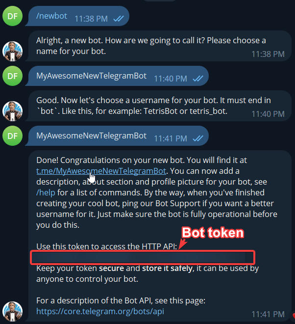
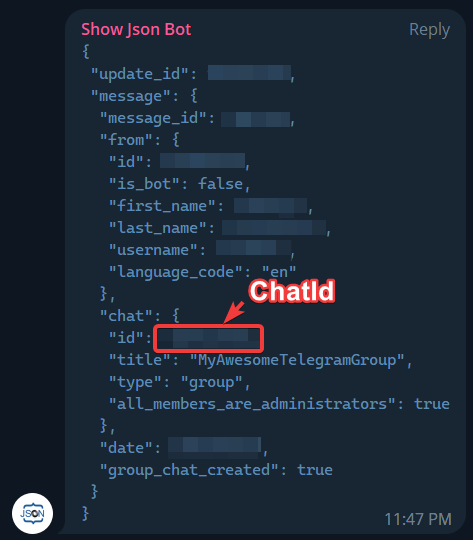

# Show a state from a Telegram message

**Telegram Message** reads new incoming messages sent to your bot. In a private chat, `review` can show “Review in progress”, and `done` can hide it. Telegram supplies the text, the trigger stores the state and a separately added overlay displays it.

You need Telegram, access from EyeAuras to the Bot API and a bot you control. Start with a private chat between a person and that bot. A notification sent by [Send To Telegram](/en/actions/send-telegram-message) is an outgoing operation, not a test of this incoming path.

## Prepare your own bot

1. Open the official [@BotFather](https://t.me/BotFather), send `/newbot` and follow its questions. Choose a display name and a unique username ending in `bot`; see [Telegram's BotFather guide](https://core.telegram.org/bots/features#botfather).
2. Keep the issued token private. It controls your bot; do not include it in screenshots, shared auras or support messages.
3. Open a private chat with your bot and choose **Start**. A reply is not required: this example reads incoming messages but does not configure automatic answers.

This older image shows the token response. Use your own token, not one from an illustration.

## Receive two commands

1. Add **Telegram Message** to an aura and enter your **Telegram Bot Token**. Initially leave **Chat Id (optional)** empty to identify your chat. Use a dedicated bot that only you are messaging for this first setup.
2. Wait for a connected state, then send a **new** message such as `my chat` from your own Telegram account. The first batch of older updates is skipped on connection, so an earlier message is not a useful test.
3. Find it in **Message history**, use **Copy Chat ID to clipboard** beside the entry and put the value in **Chat Id (optional)**. The trigger now accepts that chat only.
4. Set **Activate → Regex** to `\Areview\z`. Enable **Deactivate on message** and set its **Regex** to `\Adone\z`. Turn off **Test mode** for both conditions.
5. Add a [Text overlay](/en/overlays/text) with `Review in progress`, visible while the aura is active. Disable forced editor preview.
6. Send `review` to your bot from your user account. After the history entry arrives, the trigger should become active and the text appear. Send `done` to deactivate it and hide the text. If history has the message but the state does not change, check expressions before replacing credentials.

| Setting | Meaning |
| --- | --- |
| Telegram Bot Token | Your bot credentials for receiving updates |
| Chat Id (optional) | Exact chat identifier, including a minus sign when present. An empty value admits all chats available to the bot, not just yours |
| Proxy server (optional) | SOCKS5 proxy in host:port or username:password@host:port form, if needed; otherwise leave empty |
| Activate | Activation condition over the incoming text. An empty expression matches any accepted message |
| Deactivate on message | When enabled, retains activity until a matching deactivation message. When off, activation requests automatic deactivation after about 50 ms |
| Text / Regex / C# | [Text-matching modes](/en/features/text-match-expressions), including Ignore Case and Test mode |
| Message history / Clear history | Incoming entries and list clearing. Clearing history does not reset an active state |

Repeating `review` while already active does not create another **On Enter** transition. Unrelated text leaves a retained state unchanged when it matches neither condition. An accidentally empty deactivation expression matches every message.

## Groups and receiving limits

For a group, add your own bot and obtain Chat Id from EyeAuras history in the same way. The bot's permissions and [Telegram privacy mode](https://core.telegram.org/bots/faq#what-messages-will-my-bot-get) determine which group messages reach it. A plain phrase may be unavailable while a command addressed to the bot or a reply is available. First establish a history entry, then add a reaction.

The older screenshot uses a third-party Show Json Bot to show `chat.id`. It is an illustration of the identifier, not a required group member; the current EyeAuras history can copy the value directly.

This receiver uses [getUpdates long polling](https://core.telegram.org/bots/api#getupdates). Do not run an independent update receiver with the same token at the same time; an installed webhook also conflicts with polling. Within EyeAuras, matching token/proxy configurations share a client.

The evaluator reads the text field of new ordinary messages. Edits, channel posts, photos and their captions are not substitutes for this text path. **Chat Id** filters a chat, not individual people in a group. A private chat with a dedicated bot is simpler when only you should control the state.

Optional illustrated setup guides retained from the earlier article: [tlgrm.ru](https://tlgrm.ru/docs/bots#botfather) and [SendPulse](https://sendpulse.com/ru/knowledge-base/chatbot/create-telegram-chatbot). Their interface may differ; configure the receiving trigger rather than the outgoing action for this task.
