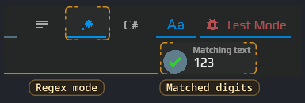

# Continue from the older Telegram Message guide

This is an old page about the **Telegram Message** trigger. It receives the text of new messages that people send to your bot. Bot setup, Chat ID and a full receiving example are in [the current Telegram guide](/en/triggers/telegram-message).

## Check an existing text condition first

Have an expression left from an old aura and want to know whether it accepts `review`? Check it without sending a Telegram message.

1. Open **Activate** in your Telegram Message trigger. For a simple try, choose **Regex** and enter `\Areview\z`.
2. Enable **Test mode** and enter `review` as the test input. It should match. Replace the input with `done`: it should not match. This tests the expression, not the Telegram connection.

   
3. Turn **Test mode** off so that the trigger reads real messages again. For a live check, set up **Telegram Bot Token** and **Chat Id (optional)** as the current guide describes, then send the bot a new message from your own account. Do not share the token together with the aura.
4. Check **Message history**. With **Deactivate on message** off, a matching message activates the trigger briefly and it deactivates on its own. To keep the state, turn the option on and set a separate off command. Add the reaction separately: in **On Enter** or as an overlay.

| Earlier label | Current setting or result |
| --- | --- |
| Text or expression | The condition's expression. **Text**, **Regex**, **C#** and **Ignore Case** are available, and the [matching rules](/en/features/text-match-expressions) describe each of them. Text compares the whole input. Regex can match part of it |
| Input test text | Test input while **Test mode** is on |
| Matching text | For Regex, capture group 1 if the expression has groups, otherwise the whole match. For Text and C#, the input on success |
| C# function | A Boolean expression that gets the input string. It is not a full Script.csx program and has no implicit access to Log/AuraTree/Variables |
| Token | Now **Telegram Bot Token**, the secret that controls your bot |
| Chat | **Chat Id (optional)**. Empty means all chats available to that bot, not only yours |

Expression testing is now next to Activate. Connection and chat fields are in the Telegram source settings.

The trigger reads the text of new ordinary messages. Old updates at connection, edits and channel posts do not count. In groups it depends on the bot's permissions and privacy settings, so get a history entry first. A notification sent by **Send To Telegram** is no good as a test of incoming messages.

Bot-setup guides from the earlier page: [tlgrm.ru — BotFather](https://tlgrm.ru/docs/bots#botfather) and [SendPulse](https://sendpulse.com/ru/knowledge-base/chatbot/create-telegram-chatbot). For current Telegram requirements see [Telegram's official guide](https://core.telegram.org/bots/features#botfather).
