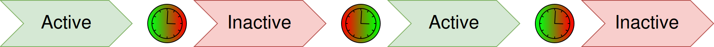

# Show your own reminder at regular intervals

Make `Time for a break` appear for about one second, then disappear for about one second. **Timer** supplies the condition from its internal cycle; you supply the text. This first example needs no game window, input or external event.

## Set up a 1000/1000 ms cycle

1. Create a separate aura without actions or other triggers. Add **Timer**. Leave inversion and extra activation/deactivation delays off.
2. Set both **Active for** and **Not Active for** to **1000**. The unit **ms** means milliseconds.
3. Under **Overlays**, add **Text**. Set **Content** to `Time for a break`, **Font** to **24**, and turn **Size to fit** off. Position the text in a clear area of the screen and enable **Locked**. See [Text](/en/overlays/text) for its other options.
4. Enable the aura, then select a different aura in the tree. The selected overlay's editing preview can keep it visible while you configure it. Watch several cycles after leaving that preview.
5. Disable the test aura with its switch. Periodic display stops. Enabling it again starts a new cycle with an inactive wait; it does not resume the previous phase's remaining time.

The cycle starts **Inactive**, waits the first interval, becomes **Active**, waits the second interval and repeats. With both values at 1000, the text is hidden for roughly one second and visible for roughly one second. One full repeat is about two seconds, not an exact wall-clock scheduling guarantee.

The earlier editor image shows two millisecond intervals. Replace **both** values with `1000` for this example, regardless of the numbers in the image.

| Setting or behaviour | What to expect |
| --- | --- |
| `Active for` and `Not Active for` | The two cycle intervals. Use `1000` in both fields for this first check. |
| Changing either interval | Restarts the cycle from Inactive with a new wait. It does not adjust the remaining time in the current phase. |
| Minimum interval | Values below `100 ms` are clamped to that minimum. `0` does not disable a phase. |
| Disabling the aura or trigger | Stops its active subscription. A disabled trigger has an unavailable/null state, not an ordinary timed Inactive phase. |
| General trigger settings | Inversion and additional activation/deactivation delays can change the observed condition. Leave them off for this example. |

For unequal intervals, first watch **Active/Inactive in your installed build** and check which duration changes with each field before attaching actions. Values such as `5000` or `15000` are milliseconds; do not assume their field-to-phase mapping without that check.

The diagram shows the repeating part: the arrows and clocks connect Active to Inactive and then to the next Active. The initial inactive wait before the first Active is described above and is not drawn separately. [Original SVG diagram](/assets/wiki-media/m076-original.svg).

Timer changes an aura condition. The response is configured separately: here it is Text visibility; another setup can use actions on a state transition. A timed skill, shop-visit or gathering sequence also needs its own configured actions, target and real conditions. Timer alone does not read an ability's cooldown, locate an NPC or know another application's state.
