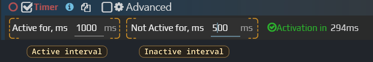

# Show your own reminder at regular intervals

**Timer** switches on and off in a loop at the intervals you set. Here it drives a reminder: `Time for a break` appears for about one second, then disappears for about one second.

## Set up a 1000/1000 ms cycle

1. Create a separate aura without actions or other triggers. Add **Timer**. Leave inversion and the extra activation and deactivation delays off.
2. Set both **Active for** and **Not Active for** to **1000**. The unit is **ms**, milliseconds.
3. Under **Overlays**, add **Text**. Set **Content** to `Time for a break`, **Font** to **24**, and turn **Size to fit** off. Put the text in a free spot on the screen and enable **Locked**. The other options are described in [Text](/en/overlays/text).
4. Enable the aura, then select a different aura in the tree: while the overlay is selected, its editing preview can keep it on screen. Watch a few cycles.
5. Disable the test aura with its switch. The text stops appearing. When you enable the aura again, the cycle starts over from the inactive wait. It does not continue the time left in the previous phase.

The cycle starts **Inactive**. Timer waits the first interval, becomes **Active**, waits the second interval, and so on in a loop.

| Setting or behaviour | What to expect |
| --- | --- |
| `Active for` and `Not Active for` | The two cycle intervals, in milliseconds. |
| Changing either interval | Restarts the cycle from Inactive with a new wait. The time left in the current phase is not adjusted. |
| Minimum interval | Values below `100 ms` are raised to that minimum. `0` does not turn a phase off. |
| Disabling the aura or trigger | A disabled aura does not run. A disabled trigger has no state, which is not the same as the ordinary Inactive phase. |
| General trigger settings | Inversion and the extra activation and deactivation delays can change the state you see. |

For unequal intervals, first watch **Active/Inactive in your installed build** and check which duration changes with each field. Attach actions after that.

[Original SVG diagram](/assets/wiki-media/m076-original.svg).

If you only need a pause between two actions, use [Delay](/en/actions/delay) instead of Timer. For a delay inside a behavior tree there is [Wait](/en/behavior-trees/nodes/wait).
