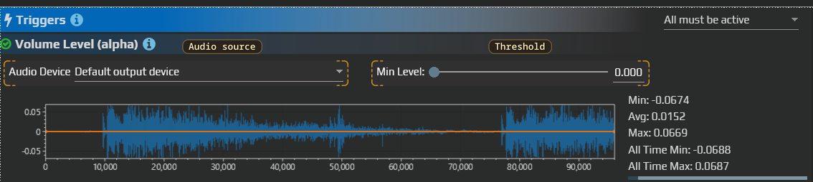

# Volume Level — historical alpha

**Volume Level** compared captured audio with a threshold. You could use it to notice that a chosen source started making sound and, for example, light an indicator. It measured the audio itself, not the Windows volume slider, and it did not recognize a particular tune or alarm.

The current EyeAuras does not list this trigger and has no editor for it. This page stays to explain the old setup.

## If you have an older aura

1. Check that your version actually opens a **Volume Level** editor and does not just keep it as an unknown configuration item. Without the editor, the rest of this page does not apply.
2. In a compatible older version, choose the capture source and your own device. A playback output and a microphone input are different sources.
3. Find **Min Level** and the level display. Play a short test sound on the chosen source and compare the readings before, during and after it. Pick the threshold from those readings, not from the Windows volume percentage.
4. First make sure the trigger turns on with the sound and off when the level drops. Then add a reaction, for example an indicator.

## What the values mean

| Setting or measurement | Meaning and limits |
| --- | --- |
| Device source | Captures an audio device. The saved model distinguishes default input, default output and a specific device |
| Process source | The saved model also has process audio capture, selected through a window |
| Min Level | The threshold. It is compared with the maximum sample value of each received buffer |
| Minimum / maximum / average | Statistics of the captured samples. Average uses absolute sample values. Activation uses the maximum, not the average |
| State | When data arrives: a maximum at or above the threshold activates the trigger, a lower one deactivates it. No new data does not mean silence, and the old result may stay |
