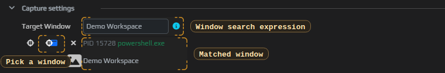

# Window Exists — detect when a window appears

Window Exists watches whether a window matching your expression exists. If one is found, the trigger is Active. If none is found, it is Not Active. For example, you can play a notification when Notepad opens.

The window can be in the background. If foreground focus matters, use [Window Is Active](/en/triggers/window-is-active).

## Notify when Notepad opens

1. Open one Notepad window. Create an aura with only **Window Exists**.
2. Enter `notepad` in **Target Window** and check that Notepad is among the matches. If other windows match too, refine the [window matching expression](/en/features/window-matching-expressions).
3. Add [Play Sound](/en/actions/play-sound) with Ping to **On Enter** and check its volume.
4. Close all windows matching the expression. Wait for Not Active.
5. Open Notepad again.

The trigger becomes Active, the aura runs On Enter and the sound plays. The sound plays again once all matching windows are gone and a matching window appears again.

## Target and states

| Setting or state | Meaning |
|---|---|
| Target Window | A window matching expression. It can use titles, processes and other information. Plain text is not matched against the title only. |
| Active | A matching window was found and could be selected. |
| Not Active | No matching window exists, or one could not be selected. |

If you pick a window from the list, the expression may store its temporary handle. Check such an expression again after restarting the program. For a notification on each launch, write an expression that also finds the program's new window.

Window Exists checks windows, not the contents of a hidden browser tab. If the expression uses a page title, switching tabs may change the window title and the match result with it. To find text inside a window, use [Text Search](/en/triggers/images/text-search).
