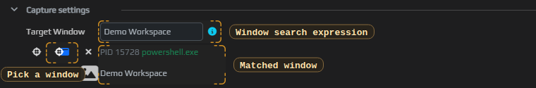

# Window Is Active — react when you return to a window

Window Is Active checks whether a matching window is in the foreground. For example, you can hear a notification when you return to Notepad.

## Notify when Notepad gains focus

1. Open Notepad. Create an aura with one **Window Is Active** trigger.
2. Enter `notepad` in **Target Window** and check the matches. Keep one Notepad window for the first try.
3. Add [Play Sound](/en/actions/play-sound) with Ping to **On Enter**. Check its volume with the preview button.
4. Switch to another program, then return to Notepad with Alt+Tab or by clicking its window.

When Notepad comes to the foreground, the trigger becomes Active and the sound plays. Switch away and it becomes Not Active. On Enter does not repeat while Notepad stays in the foreground.

## Target and states

| Setting or state | Meaning |
|---|---|
| Target Window | A [window matching expression](/en/features/window-matching-expressions). With several matches, the condition is true when any one of them is in the foreground. |
| Active | The foreground window is in the matching list. |
| Not Active | Another window is in the foreground, there are no matches, or the current window could not be determined. Closing Notepad also gives Not Active. |

A missing window gives Not Active, not Unknown. Unknown can show up before the trigger is running or when it is disabled.

## Restrict a hotkey to one application

Create a separate aura with Window Is Active and the chosen target. Then, in the [Hotkey Is Active](/en/triggers/hotkey-is-active) trigger of another aura, add that aura through **Interception Condition → Links**. This link decides when the key is processed at all. Putting both triggers into one aura does not give you an interception condition.

If you only need to know that the program is open while you work elsewhere, use [Window Exists](/en/triggers/window-exists).
